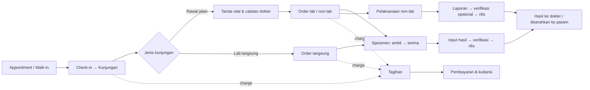
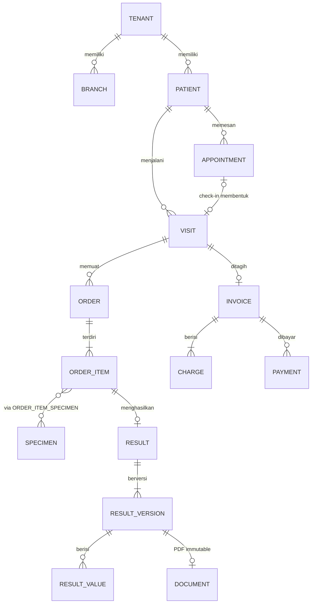
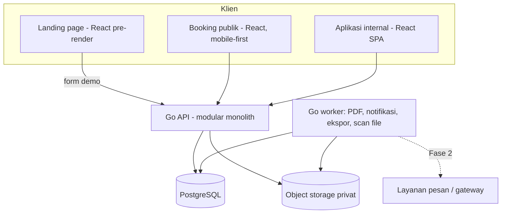

# PRD — [Nama Produk]

| Atribut         | Nilai                                                                                                                  |
| --------------- | ---------------------------------------------------------------------------------------------------------------------- |
| Versi dokumen   | 0.2 (draft; revisi fokus klinik pratama, 13 November 2026)                                                             |
| Status          | **Belum disetujui.** Dokumen ini bukan persetujuan klinis, bukti kepatuhan regulasi, atau spesifikasi integrasi resmi. |
| Stack wajib     | Backend Golang, frontend React JS, database PostgreSQL                                                                 |
| Pemilik dokumen | Product Manager (TBD)                                                                                                  |
| Validator wajib | Tenaga klinis (dokter/perawat), penanggung jawab laboratorium, ahli regulasi dan hukum, keamanan informasi             |

**Konvensi penandaan dalam dokumen**

- **[Kebutuhan]**: kebutuhan pengguna atau bisnis yang berasal dari brief.
- **[Asumsi]**: dianggap benar sementara dan harus divalidasi.
- **[Rekomendasi]**: usulan tim produk atau arsitektur dan dapat diganti.
- **[Belum dikonfirmasi]**: keputusan terbuka yang memengaruhi desain atau cakupan.
- **[Usulan]**: angka target yang belum disepakati.
- **[Validasi klinis]**, **[Validasi lab]**, **[Validasi regulasi]**: wajib ditinjau oleh pihak berwenang sebelum digunakan dengan data pasien nyata.

### Revisi 0.2 — fokus klinik pratama

Versi 0.1 terlalu berat ke alur laboratorium, sementara kebutuhan harian klinik (resep, obat, BPJS, SATUSEHAT, ICD-10) berada di Fase 3. Revisi ini mengubah urutan prioritas tanpa menghapus kebutuhan lab:

1. **Segmen pilot pertama: klinik pratama rawat jalan.** Mode lab mandiri dan kombinasi tetap didukung model data, tetapi tidak menjadi syarat MVP.
2. **Naik ke MVP:** diagnosis ICD-10 dan tindakan ICD-9-CM (VIS-005), resep dan farmasi sederhana dengan stok (VIS-009, FAR-001–004), charge konsultasi/tindakan otomatis (BILL-002), penjamin umum/BPJS pada kunjungan dan kasir (BILL-012), serta kesiapan SATUSEHAT (§21) **[Validasi regulasi]**.
3. **Turun ke Fase 2:** alur spesimen lengkap (label, penolakan, pengganti), rerun, tugas nilai kritis, rilis parsial, versi hasil lengkap, multi-mode tenant, dan landing page publik. Lab di MVP cukup order ke lab internal sederhana atau rujukan luar, dengan input/unggah hasil dan satu langkah verifikasi.
4. **Alur harian MVP:** pendaftaran → antrean → perawat (tanda vital) → dokter (SOAP, ICD-10, tindakan, resep, order) → farmasi (dispensing) → kasir (umum/BPJS) → kunjungan ditutup → kirim data ke SATUSEHAT (bila diwajibkan).
5. **UI aplikasi internal** mengikuti design system AdminMart yang dibangun ulang dengan Tailwind CSS (§20.8). Arahan §23.2 hanya berlaku untuk landing page.

---

## 1. Ringkasan dan Positioning

### 1.1 Ringkasan produk

[Nama Produk] adalah aplikasi web SaaS multi-tenant untuk klinik rawat jalan, laboratorium mandiri, dan fasilitas yang memiliki keduanya. Produk menghubungkan identitas pasien, appointment, kunjungan rawat jalan, order pemeriksaan laboratorium dan non-laboratorium, spesimen, hasil, verifikasi, rilis, serta tagihan dalam satu alur yang dapat ditelusuri.

Produk memisahkan tujuh objek inti yang sering tercampur di sistem lain:

| Objek       | Arti                                                                    | Bukan                                                    |
| ----------- | ----------------------------------------------------------------------- | -------------------------------------------------------- |
| Pasien      | Identitas orang dalam satu organisasi, termasuk nomor rekam medis (MRN) | Bukan kunjungan dan bukan akun portal                    |
| Appointment | Reservasi waktu pada sumber daya                                        | Bukan bukti bahwa pelayanan sudah berlangsung            |
| Kunjungan   | Episode pelayanan nyata yang dimulai saat check-in atau walk-in         | Bukan appointment                                        |
| Order       | Permintaan pemeriksaan beserta item-itemnya                             | Bukan hasil dan bukan tagihan                            |
| Spesimen    | Bahan fisik yang diambil, diberi label, dan diterima laboratorium       | Bukan order; satu order dapat memiliki beberapa spesimen |
| Hasil       | Data pemeriksaan per item yang memiliki versi                           | Bukan dokumen PDF; PDF adalah turunan dari versi hasil   |
| Tagihan     | Kewajiban finansial yang dibentuk dari charge                           | Status bayar tidak sama dengan status klinis             |

### 1.2 Positioning

**[Rekomendasi] Pernyataan positioning:**

> Untuk klinik rawat jalan dan laboratorium yang masih mencatat pendaftaran, order, spesimen, hasil, dan pembayaran di tempat terpisah, [Nama Produk] menyediakan satu alur kerja dari appointment sampai hasil dirilis. Setiap langkah tercatat beserta pelaksana dan waktunya, sehingga staf dapat melihat status pasien tanpa menanyakannya ke bagian lain.

**Pembeda yang dapat dibuktikan melalui demo:** keterlacakan _pasien → order → item → spesimen → hasil → versi_, pemisahan status klinis dari status pembayaran, serta koreksi hasil melalui versi baru tanpa menghapus histori.

**Yang tidak diklaim:** rekam medis elektronik lengkap, peningkatan akurasi diagnosis, peningkatan keselamatan pasien, penghematan dalam angka tertentu, kepatuhan regulasi tertentu, atau integrasi yang belum diuji.

---

## 2. Masalah, Tujuan, dan Metrik Keberhasilan

### 2.1 Masalah [Asumsi — perlu divalidasi melalui discovery]

1. Data pasien dicatat berulang di pendaftaran, laboratorium, dan kasir.
2. Staf tidak mengetahui status pemeriksaan tanpa menghubungi bagian lain.
3. Hubungan spesimen dengan order dan hasil dicatat manual sehingga sulit ditelusuri saat terjadi masalah.
4. Koreksi hasil dilakukan dengan menimpa data sehingga versi sebelumnya hilang.
5. Status pembayaran tercampur dengan status pelayanan, sehingga ada risiko penagihan ganda atau tertundanya informasi klinis.
6. Hak akses terlalu luas: petugas yang tidak membutuhkan data klinis tetap dapat membacanya.

### 2.2 Tujuan produk

| ID  | Tujuan                                                                                                                                               |
| --- | ---------------------------------------------------------------------------------------------------------------------------------------------------- |
| G1  | Satu alur lengkap: pendaftaran/appointment → check-in → kunjungan atau order langsung → pemeriksaan → verifikasi → rilis → penyelesaian administrasi |
| G2  | Data pasien dan order dimasukkan satu kali, lalu dipakai ulang oleh modul lain                                                                       |
| G3  | Status pasien, order, spesimen, hasil, dan pembayaran terlihat oleh peran yang berhak                                                                |
| G4  | Setiap perubahan sensitif dapat diaudit, dan data klinis yang sudah ditandatangani tidak dapat ditimpa                                               |
| G5  | Akses diberikan berdasarkan peran, organisasi, cabang, dan hubungan pelayanan                                                                        |

### 2.3 Metrik keberhasilan [Usulan — diukur saat pilot]

| Metrik                 | Definisi                                                                                          | Target usulan                                                        |
| ---------------------- | ------------------------------------------------------------------------------------------------- | -------------------------------------------------------------------- |
| Keterlacakan hasil     | % hasil lab yang dirilis dan dapat ditelusuri ke spesimen, pelaksana, verifikator, serta versinya | 100% (invarian sistem; diuji otomatis)                               |
| Double booking         | Jumlah slot berkapasitas 1 yang terisi lebih dari satu appointment aktif                          | 0                                                                    |
| Charge ganda           | Jumlah charge aktif ganda untuk sumber yang sama                                                  | 0                                                                    |
| Input ulang data       | % order lab yang perlu diketik ulang di modul lain                                                | 0% untuk identitas pasien dan item order                             |
| Penyelesaian tugas UAT | % skenario UAT alur utama yang diselesaikan staf tanpa bantuan                                    | ≥ 90%                                                                |
| Waktu menemukan status | Median waktu staf menjawab "hasil pasien X sudah sampai mana?"                                    | Baseline diukur sebelum pilot; target ditetapkan setelahnya          |
| Konversi landing page  | % pengunjung yang mengirim form demo                                                              | Baseline dikumpulkan 4 minggu pertama; tanpa target sebelum ada data |

---

## 3. Persona dan Jenis Fasilitas

### 3.1 Jenis fasilitas (mode tenant)

| Mode                                                                                             | Modul aktif                                                                                                                                       | Alur khas                                                                                                            |
| ------------------------------------------------------------------------------------------------ | ------------------------------------------------------------------------------------------------------------------------------------------------- | -------------------------------------------------------------------------------------------------------------------- |
| Klinik rawat jalan                                                                               | Pasien, appointment, kunjungan, catatan klinis, order non-lab, order lab ke pihak luar (hanya pencatatan; rujukan eksternal di luar MVP), billing | Appointment → kunjungan dokter → tindakan/non-lab → kasir                                                            |
| Laboratorium mandiri                                                                             | Pasien, appointment (opsional), order langsung, spesimen, hasil, billing                                                                          | Pendaftaran → order langsung (pengantar dokter eksternal                                                             |
| atau atas permintaan sendiri sesuai kebijakan fasilitas) → spesimen → verifikasi → rilis → kasir |
| Klinik dengan laboratorium                                                                       | Seluruh modul                                                                                                                                     | Kunjungan dokter → order lab internal → spesimen → hasil kembali ke dokter → kasir; pasien lab mandiri juga didukung |

**[Belum dikonfirmasi]** Kebijakan pemeriksaan laboratorium atas permintaan sendiri (tanpa pengantar dokter) dapat dibatasi oleh regulasi dan kebijakan fasilitas. Produk hanya menyediakan opsi konfigurasi asal order dan tidak menentukan kebolehannya. **[Validasi regulasi]**

### 3.2 Persona

| Persona                       | Kebutuhan utama                                 | Hambatan saat ini [Asumsi]                                 |
| ----------------------------- | ----------------------------------------------- | ---------------------------------------------------------- |
| Pengelola fasilitas (pembeli) | Visibilitas operasional, kontrol akses, laporan | Data tersebar di beberapa tempat dan laporan dibuat manual |
| Resepsionis                   | Pendaftaran cepat, pencarian pasien, antrean    | Ketik ulang data dan duplikasi pasien                      |
| Dokter                        | Riwayat relevan, catatan, order, hasil kembali  | Hasil tiba terpisah dari catatan kunjungan                 |
| Perawat                       | Tanda vital, persiapan pasien                   | Pencatatan di kertas lalu disalin                          |
| Petugas sampling              | Identifikasi pasien, label yang benar           | Risiko salah label                                         |
| Analis lab                    | Worklist, input hasil, pengulangan              | Pencatatan hasil manual tanpa jejak                        |
| Verifikator                   | Review, verifikasi, rilis, koreksi              | Sulit melihat histori koreksi                              |
| Petugas non-lab               | Form pemeriksaan dan unggah laporan             | Laporan berupa file lepas                                  |
| Kasir                         | Tagihan akurat, pembayaran sebagian             | Penagihan ganda atau terlewat                              |
| Pasien                        | Booking melalui ponsel dan akses hasil (Fase 2) | Telepon berulang untuk menanyakan jadwal atau hasil        |

---

## 4. Asumsi dan Keputusan Terbuka

### 4.1 Asumsi

| ID     | Asumsi                                                                                                                                      | Dampak jika salah                                                                                 |
| ------ | ------------------------------------------------------------------------------------------------------------------------------------------- | ------------------------------------------------------------------------------------------------- |
| ASM-01 | Tenant = satu organisasi (badan usaha/pemilik). Cabang = lokasi fasilitas di dalam tenant.                                                  | Model data dan billing SaaS perlu didesain ulang                                                  |
| ASM-02 | MVP: satu cabang aktif per organisasi, tetapi semua tabel operasional memiliki `branch_id`                                                  | Multi-cabang di Fase 2 tidak memerlukan migrasi besar                                             |
| ASM-03 | Bahasa antarmuka MVP: Bahasa Indonesia. Mata uang: IDR.                                                                                     | Lokalisasi tambahan                                                                               |
| ASM-04 | Input hasil lab dilakukan manual pada MVP                                                                                                   | Jika analyzer wajib, jadwal bertambah signifikan                                                  |
| ASM-05 | Portal pasien untuk hasil tidak masuk MVP; hasil diserahkan oleh staf (cetak/PDF)                                                           | Jika wajib, perlu autentikasi pasien dan notifikasi                                               |
| ASM-06 | Online-only; tidak ada mode offline                                                                                                         | Perlu prosedur downtime manual                                                                    |
| ASM-07 | Tanda tangan di aplikasi = atestasi elektronik melalui autentikasi ulang pengguna, bukan tanda tangan elektronik tersertifikasi             | Jika TTE tersertifikasi diwajibkan, perlu integrasi penyelenggara terkait **[Validasi regulasi]** |
| ASM-08 | Fasilitas memiliki prosedur klinis tertulis (identifikasi pasien, nilai kritis, penolakan spesimen); aplikasi mendukung, bukan menggantikan | Risiko klinis bila prosedur tidak ada                                                             |

### 4.2 Keputusan terbuka (ringkas; detail di Bagian 27)

| ID     | Keputusan                                                | Rekomendasi sementara                                                                                                                  |
| ------ | -------------------------------------------------------- | -------------------------------------------------------------------------------------------------------------------------------------- |
| DEC-01 | Verifikasi dan rilis: satu atau dua langkah              | Dapat dikonfigurasi per kategori; default dua langkah, dengan opsi "verifikasi sekaligus rilis" bagi pengguna yang memiliki kedua izin |
| DEC-02 | Gate pembayaran terhadap pelaksanaan dan rilis ke pasien | Dapat dikonfigurasi; default tanpa gate klinis. Gate hanya untuk penyerahan dokumen ke pasien bila fasilitas memilihnya                |
| DEC-03 | Portal pasien di MVP                                     | Fase 2                                                                                                                                 |
| DEC-04 | Refund di MVP                                            | Pencatatan refund manual (Should, MVP)                                                                                                 |
| DEC-05 | Penyimpanan lampiran                                     | Object storage kompatibel S3, metadata di PostgreSQL                                                                                   |
| DEC-06 | Pemisah verifikator dan analis (separation of duties)    | Default dilarang; dapat diizinkan per tenant dengan audit untuk lab kecil                                                              |
| DEC-07 | Daftar kode diagnosis                                    | Teks bebas dan daftar kode yang diimpor tenant; sumber dan lisensi perlu dikonfirmasi                                                  |
| DEC-08 | Jenis layanan non-lab di MVP                             | Mesin template generik dan 1–2 layanan pilot yang divalidasi                                                                           |

---

## 5. Cakupan MVP dan Batas Produk

| Area         | MVP (Fase 1)                                                                                                                                              | Fase 2                                                                                      | Fase 3 / kandidat                             | Di luar cakupan                  |
| ------------ | --------------------------------------------------------------------------------------------------------------------------------------------------------- | ------------------------------------------------------------------------------------------- | --------------------------------------------- | -------------------------------- |
| Tenant       | Organisasi, 1 cabang aktif, mode klinik pratama                                                                                                           | Multi-cabang, mode lab mandiri/kombinasi penuh                                              | Rujukan antar-organisasi                      | —                                |
| Pasien       | Registrasi, MRN, NIK, nomor BPJS, wali, pencarian, deteksi duplikat, merge, persetujuan                                                                   | Unmerge terpandu, portal pasien                                                             | —                                             | Master patient index nasional    |
| Appointment  | Jadwal dokter, slot, booking staf, walk-in, antrean per poli, check-in                                                                                    | Booking publik, pengingat email/WhatsApp, daftar tunggu                                     | Display antrean TV                            | —                                |
| Kunjungan    | Tanda vital, SOAP, diagnosis ICD-10, tindakan ICD-9-CM, resep, order, tanda tangan, addendum                                                              | Template klinis lanjutan                                                                    | —                                             | Rawat inap, IGD, operasi         |
| Farmasi      | Master obat, stok per batch/kedaluwarsa, resep elektronik, dispensing, mutasi stok teraudit                                                               | Pembelian/penerimaan dari supplier, stok opname terjadwal                                   | Resep racikan kompleks, integrasi apotek luar | Distribusi farmasi               |
| Lab          | Order lab internal sederhana atau rujukan luar, input/unggah hasil, satu langkah verifikasi                                                               | Spesimen/barcode, penerimaan/penolakan, rerun, versi/koreksi lengkap, nilai kritis, PDF, QC | Analyzer pilot                                | Dukungan semua analyzer          |
| Non-lab      | Unggah laporan PDF/gambar per order                                                                                                                       | Template form, verifikasi opsional                                                          | DICOM viewer, PACS                            | Interpretasi otomatis            |
| Billing      | Tarif, snapshot, charge konsultasi/tindakan/obat/order otomatis, penjamin umum/BPJS, diskon berotorisasi, tunai/nontunai manual, sebagian, void, kuitansi | Refund, payment gateway                                                                     | Asuransi swasta, akuntansi                    | Akuntansi penuh/ERP              |
| Pelaporan    | Dashboard operasional, kunjungan per poli/dokter, 10 besar diagnosis, pendapatan, pemakaian obat                                                          | TAT lab, laporan kustom, ekspor teraudit                                                    | BI eksternal                                  | —                                |
| Integrasi    | Kesiapan SATUSEHAT (Encounter, Condition, Observation) dan BPJS bila diwajibkan fasilitas pilot **[Validasi regulasi]**                                   | Layanan pesan, payment gateway, cetak label/scanner                                         | Analyzer                                      | —                                |
| Landing page | —                                                                                                                                                         | Halaman publik, form demo                                                                   | Konten studi kasus                            | Harga publik (sampai ditetapkan) |

**Batas produk vs prosedur klinis:** aplikasi mencatat, menegakkan izin, mengatur alur status, dan menyimpan histori. Keputusan klinis (diagnosis, terapi, interpretasi, kelayakan spesimen, nilai rujukan, ambang kritis, cara komunikasi nilai kritis) tetap menjadi tanggung jawab tenaga berwenang dan prosedur fasilitas. Aplikasi tidak menghasilkan diagnosis, saran terapi, dosis, atau nilai rujukan bawaan.

---

## 6. Peran dan Matriks Hak Akses

### 6.1 Prinsip

- Akses = **peran × organisasi × cabang × hubungan pelayanan** (bila relevan) × izin granular.
- Satu pengguna dapat memiliki lebih dari satu peran. Izin dihitung sebagai gabungan, kecuali aturan separation of duties.
- Admin organisasi mengelola konfigurasi dan pengguna, tetapi **tidak otomatis membaca catatan klinis atau hasil**.
- Admin platform tidak memiliki akses data pasien secara default (lihat SEC-006).
- Manajer fasilitas melihat data agregat, bukan detail klinis.

### 6.2 Singkatan peran

AO = Admin organisasi · RS = Resepsionis · DR = Dokter · PR = Perawat · SP = Petugas spesimen · AL = Analis lab · VF = Verifikator hasil · NL = Petugas non-lab · KS = Kasir · MF = Manajer fasilitas · PS = Pasien · AP = Admin platform

Legenda: ✔ = penuh dalam cakupan cabang · ◐ = terbatas (lihat catatan) · — = tidak ada akses

### 6.3 Matriks

| #   | Sumber daya / aksi                                                                   | AO             | RS             | DR                     | PR                   | SP         | AL         | VF            | NL                 | KS              | MF        | PS                          | AP  |
| --- | ------------------------------------------------------------------------------------ | -------------- | -------------- | ---------------------- | -------------------- | ---------- | ---------- | ------------- | ------------------ | --------------- | --------- | --------------------------- | --- |
| 1   | Konfigurasi organisasi, cabang, mode, pengguna, peran                                | ✔              | —              | —                      | —                    | —          | —          | —             | —                  | —               | —         | —                           | ◐¹  |
| 2   | Katalog administratif (kode, nama, harga)                                            | ✔              | —              | —                      | —                    | —          | —          | —             | —                  | —               | ◐ baca    | —                           | —   |
| 3   | Konfigurasi klinis katalog (parameter, satuan, metode, nilai rujukan, ambang kritis) | ◐²             | —              | —                      | —                    | —          | ◐ draft    | ✔ setujui³    | ◐ template non-lab | —               | —         | —                           | —   |
| 4   | Baca identitas pasien                                                                | —              | ✔              | ✔                      | ✔                    | ◐⁴         | ◐⁴         | ◐⁴            | ◐⁴                 | ◐⁵              | —         | ◐ diri/tanggungan           | —   |
| 5   | Buat/ubah identitas pasien                                                           | —              | ✔              | —                      | ◐ kontak             | —          | —          | —             | —                  | —               | —         | —                           | —   |
| 6   | Merge pasien                                                                         | —              | ◐⁶             | —                      | —                    | —          | —          | —             | —                  | —               | ◐⁶        | —                           | —   |
| 7   | Kelola appointment                                                                   | —              | ✔              | ◐ jadwal sendiri       | ◐                    | —          | —          | —             | ◐ jadwal sendiri   | —               | ◐ agregat | ◐ milik sendiri             | —   |
| 8   | Antrean: lihat/panggil                                                               | —              | ✔              | ◐ antrean sendiri      | ✔                    | ◐ sampling | ◐          | —             | ◐ antrean sendiri  | ◐ kasir         | ◐ agregat | —                           | —   |
| 9   | Catat tanda vital                                                                    | —              | —              | ✔                      | ✔                    | —          | —          | —             | ◐⁷                 | —               | —         | —                           | —   |
| 10  | Baca catatan klinis (SOAP, diagnosis)                                                | —              | —              | ◐⁸                     | ◐⁸                   | —          | —          | —             | —                  | —               | —         | — MVP                       | —   |
| 11  | Tulis dan tanda tangani catatan klinis                                               | —              | —              | ✔ kunjungan ditugaskan | ◐ bagian keperawatan | —          | —          | —             | —                  | —               | —         | —                           | —   |
| 12  | Buat order                                                                           | —              | ◐⁹             | ✔                      | ◐¹⁰                  | —          | —          | —             | —                  | —               | —         | —                           | —   |
| 13  | Batalkan item order                                                                  | —              | ◐¹¹            | ◐¹¹                    | —                    | —          | ◐¹¹        | ◐¹¹           | ◐¹¹                | —               | —         | —                           | —   |
| 14  | Ambil dan beri label spesimen                                                        | —              | —              | —                      | ◐                    | ✔          | ◐          | —             | —                  | —               | —         | —                           | —   |
| 15  | Terima/tolak spesimen                                                                | —              | —              | —                      | —                    | —          | ✔          | ✔             | —                  | —               | —         | —                           | —   |
| 16  | Input hasil lab dan rerun                                                            | —              | —              | —                      | —                    | —          | ✔          | ✔             | —                  | —               | —         | —                           | —   |
| 17  | Verifikasi/rilis hasil lab                                                           | —              | —              | —                      | —                    | —          | —          | ✔             | —                  | —               | —         | —                           | —   |
| 18  | Koreksi hasil yang dirilis                                                           | —              | —              | —                      | —                    | —          | ◐ ajukan   | ✔             | ◐ ajukan non-lab   | —               | —         | —                           | —   |
| 19  | Baca hasil lab                                                                       | —              | ◐¹²            | ◐⁸                     | ◐⁸                   | —          | ◐ worklist | ✔ cakupan lab | —                  | —               | —         | ◐ Fase 2                    | —   |
| 20  | Input/verifikasi hasil non-lab                                                       | —              | —              | ◐¹³                    | —                    | —          | —          | —             | ✔ input; ◐¹³       | —               | —         | —                           | —   |
| 21  | Tagihan dan pembayaran                                                               | —              | ◐ lihat status | ◐ indikator status     | ◐ indikator status   | —          | —          | —             | —                  | ✔               | ◐ laporan | ◐ kuitansi sendiri (Fase 2) | —   |
| 22  | Diskon                                                                               | —              | —              | —                      | —                    | —          | —          | —             | —                  | ◐ hingga batas  | ✔ setujui | —                           | —   |
| 23  | Void pembayaran dan refund                                                           | —              | —              | —                      | —                    | —          | —          | —             | —                  | ◐ ajukan        | ✔ setujui | —                           | —   |
| 24  | Dashboard operasional                                                                | ◐ tanpa klinis | ◐              | ◐                      | ◐                    | ◐          | ◐          | ◐             | ◐                  | ◐               | ✔ agregat | —                           | —   |
| 25  | Laporan keuangan                                                                     | —              | —              | —                      | —                    | —          | —          | —             | —                  | ◐ shift sendiri | ✔         | —                           | —   |
| 26  | Ekspor data                                                                          | ◐ audit        | —              | —                      | —                    | —          | —          | ◐ lab         | —                  | —               | ◐ agregat | —                           | —   |
| 27  | Baca log audit                                                                       | ✔ metadata¹⁴   | —              | —                      | —                    | —          | —          | —             | —                  | —               | ◐         | —                           | ◐¹  |
| 28  | Break-glass (akses darurat)                                                          | —              | —              | ◐ dengan alasan        | ◐ dengan alasan      | —          | —          | —             | —                  | —               | —         | —                           | —   |

**Catatan:**

1. AP hanya melakukan provisioning tenant dan dukungan teknis. Akses ke data tenant hanya melalui sesi dukungan yang disetujui tenant, berbatas waktu, dan diaudit (SEC-006).
2. AO dapat mengaktifkan atau menonaktifkan item, tetapi tidak menyetujui konten klinis.
3. Izin `catalog.clinical.approve` diberikan kepada penanggung jawab lab atau pihak berwenang yang ditunjuk fasilitas.
4. Hanya identitas minimum untuk identifikasi (nama, tanggal lahir, MRN, jenis kelamin bila dibutuhkan untuk konteks nilai rujukan) serta informasi klinis yang dicantumkan pada order.
5. Nama, MRN, dan kontak untuk kuitansi.
6. Hanya pengguna dengan izin `patient.merge`.
7. Hanya jika layanan non-lab tersebut dikonfigurasi sebagai pengukuran tanda vital.
8. Hanya untuk pasien dalam hubungan pelayanan: kunjungan aktif yang ditugaskan, pemesan order, atau pernah menangani pasien. Cakupan riwayat dikonfigurasi tenant. **[Validasi klinis]**
9. Hanya order laboratorium mandiri dengan pencatatan pemesan eksternal atau permintaan sendiri.
10. Jika fasilitas mendelegasikan kewenangan. **[Belum dikonfirmasi]**
11. Lihat ORD-008 untuk aturan per status.
12. Hanya mencetak atau mengunduh dokumen yang sudah dirilis untuk diserahkan, jika diizinkan fasilitas (izin `result.handover`).
13. Interpretasi dan verifikasi non-lab hanya oleh tenaga yang ditetapkan pada konfigurasi layanan.
14. Metadata audit (siapa, kapan, aksi, objek) tanpa isi klinis.

**Label penagihan:** nama layanan pada tagihan dapat mengungkap informasi sensitif. Katalog menyediakan field "label penagihan" opsional untuk kuitansi. **[Validasi klinis/regulasi]**

---

## 7. Alur Pelayanan Utama

### 7.1 Alur end-to-end

### 7.2 Hubungan antarmodul

| Modul       | Menghasilkan                             | Dikonsumsi oleh                                          |
| ----------- | ---------------------------------------- | -------------------------------------------------------- |
| Pasien      | `patient_id`, MRN                        | Semua modul                                              |
| Appointment | Reservasi, check-in                      | Kunjungan (membentuk/menautkan kunjungan)                |
| Kunjungan   | `visit_id`, catatan, diagnosis, tindakan | Order, billing (charge konsultasi/tindakan)              |
| Katalog     | Item dan versi konfigurasi               | Order, hasil, billing                                    |
| Order       | Order dan item dengan snapshot katalog   | Lab, non-lab, billing                                    |
| Lab         | Spesimen, hasil lab                      | Hasil, pelaporan                                         |
| Non-lab     | Laporan non-lab                          | Hasil, pelaporan                                         |
| Hasil       | Versi hasil, PDF                         | Kunjungan (tampilan dokter), portal (Fase 2)             |
| Billing     | Tagihan, pembayaran                      | Pelaporan; indikator status bagi modul lain (hanya baca) |

**Aturan lintas modul:** billing tidak pernah mengubah status klinis. Modul klinis hanya membaca indikator status bayar dan tidak bergantung padanya, kecuali gate yang dikonfigurasi (BILL-009).

### 7.3 Varian alur

- **Klinik:** appointment → check-in → antrean → perawat (tanda vital) → dokter (SOAP, order) → tindakan/non-lab → kasir → kunjungan ditutup. Hasil lab dapat menyusul setelah kunjungan ditutup.
- **Lab mandiri:** pendaftaran (dengan atau tanpa appointment) → kunjungan tipe `lab_langsung` → order langsung (pemesan eksternal atau permintaan sendiri) → kasir (bila gate sebelum pelaksanaan aktif) → sampling → lab → rilis → penyerahan.
- **Kombinasi:** order internal dari dokter masuk ke worklist lab yang sama. Hasil muncul di halaman kunjungan dokter pemesan.

---

## 8. Manajemen Pasien

**PAT-001 — Registrasi pasien dan MRN**
Must · MVP · Peran: RS · Dependensi: SEC-001, SEC-012

- Aturan:
  - MRN unik per organisasi (`UNIQUE(tenant_id, mrn)`), dibuat otomatis dengan format yang dapat dikonfigurasi.
  - MRN tidak dapat diubah dan tidak dipakai ulang, termasuk setelah merge.
  - Field wajib minimum: nama lengkap, tanggal lahir (atau penanda "perkiraan"), jenis kelamin sesuai daftar yang dikonfigurasi, dan minimal satu cara kontak atau penanggung jawab.
- AC:
  - Given RS mengisi field wajib, when menyimpan, then pasien dibuat dengan MRN unik dan peristiwa `patient.created` tercatat di audit.
  - Given dua permintaan pembuatan pasien bersamaan, when keduanya disimpan, then tidak ada MRN ganda.
  - Given pasien sudah di-merge, when MRN lama dicari, then sistem mengarahkan ke pasien penerus.

**PAT-002 — Pasien tanpa identitas nasional atau email**
Must · MVP · Peran: RS · Dependensi: PAT-001

- Aturan:
  - Nomor identitas nasional, email, dan nomor telepon bersifat opsional.
  - Tipe identitas dapat dipilih (identitas nasional, paspor, lainnya, tidak ada).
  - Pasien tanpa identitas ditandai agar lebih mudah ditinjau dalam deteksi duplikat.
  - Nomor identitas unik per tenant per tipe jika diisi.
- AC:
  - Given pasien tanpa email dan identitas nasional, when disimpan dengan field wajib, then berhasil.
  - Given nomor identitas nasional yang sudah dipakai pasien lain di tenant yang sama, when disimpan, then ditolak dengan tautan ke pasien yang sudah ada (jika pengguna berhak melihatnya).

**PAT-003 — Pasien anak dan wali/penanggung jawab**
Must · MVP · Peran: RS · Dependensi: PAT-001

- Aturan:
  - Relasi penanggung jawab disimpan dengan tipe hubungan, kontak, dan periode berlaku.
  - Penanggung jawab dapat berupa pasien lain atau kontak non-pasien.
  - Batas usia yang mewajibkan wali dikonfigurasi fasilitas. **[Validasi regulasi]**
- AC:
  - Given usia pasien di bawah batas yang dikonfigurasi, when disimpan tanpa penanggung jawab, then sistem memberi peringatan atau memblokir sesuai konfigurasi.
  - Given penanggung jawab diubah, then relasi lama tetap tersimpan sebagai riwayat.

**PAT-004 — Pencarian pasien**
Must · MVP · Peran: RS, DR, PR, SP, AL, VF, NL, KS (sesuai cakupan) · Dependensi: SEC-002

- Aturan:
  - Pencarian dapat dilakukan berdasarkan MRN, nama (toleran terhadap typo), tanggal lahir, telepon, dan nomor identitas.
  - Hasil hanya menampilkan field sesuai peran.
  - Pencarian dengan kriteria terlalu luas dibatasi jumlah hasilnya.
- AC:
  - Given 50.000 pasien dalam tenant, when mencari dengan nama dan tanggal lahir, then hasil muncul ≤ 1 detik p95 [Usulan].
  - Given pengguna dari tenant B, when mencari, then pasien tenant A tidak pernah muncul.
  - Given KS mencari pasien, then hasil tidak menampilkan riwayat klinis.

**PAT-005 — Deteksi kemungkinan duplikat**
Must · MVP · Peran: RS · Dependensi: PAT-004

- Aturan:
  - Saat registrasi, sistem menghitung kandidat duplikat berdasarkan kombinasi kecocokan nama, tanggal lahir, telepon, nomor identitas, dan nama penanggung jawab.
  - Kesamaan nama saja tidak cukup untuk menandai pasien sebagai duplikat kuat.
  - Sistem tidak pernah menggabungkan pasien secara otomatis.
- AC:
  - Given pasien baru dengan nama dan tanggal lahir yang sama dengan pasien lain, when disimpan, then muncul daftar kandidat dan pengguna harus memilih "pakai pasien ini" atau "tetap buat baru" dengan alasan.
  - Given hanya nama yang sama, then pasien tidak ditandai sebagai duplikat kuat.
  - Given pengguna memilih "tetap buat baru", then keputusan dan alasannya tercatat di audit.

**PAT-006 — Merge pasien**
Must · MVP · Peran: pengguna dengan `patient.merge` · Dependensi: PAT-005, SEC-003

- Aturan:
  - Pengguna memilih pasien penerus dan pasien sumber, meninjau perbandingan field, lalu memilih nilai yang dipertahankan.
  - Seluruh kunjungan, appointment, order, spesimen, hasil, dokumen, dan tagihan dipindahkan ke pasien penerus dalam satu transaksi.
  - Pasien sumber berstatus `merged` dengan `merged_into_id`. Pasien sumber tidak dihapus.
  - Tabel pemetaan merge menyimpan referensi yang dipindahkan agar unmerge di Fase 2 dapat dilakukan.
  - PDF hasil yang sudah dirilis tidak diubah. Tampilan menunjukkan bahwa MRN lama telah di-merge.
  - Merge diblokir jika kedua pasien memiliki kunjungan aktif yang sedang `dalam_pelayanan`, kecuali disetujui supervisor.
- AC:
  - Given merge disetujui, when diproses, then semua referensi berpindah atomik; jika satu langkah gagal, tidak ada perubahan.
  - Given merge selesai, then audit mencatat pelaksana, alasan, ID kedua pasien, dan jumlah objek yang dipindahkan.
  - Given pengguna tanpa `patient.merge`, when mencoba merge melalui API, then respons 403.

**PAT-007 — Riwayat pasien sesuai hak akses**
Must · MVP · Peran: semua peran klinis dan operasional sesuai matriks · Dependensi: SEC-002

- Aturan:
  - Halaman pasien menampilkan tab riwayat (kunjungan, order, hasil, dokumen, tagihan).
  - Tab dan isi difilter oleh izin di backend, bukan hanya disembunyikan di frontend.
  - Setiap pembukaan hasil atau catatan klinis tercatat sebagai peristiwa akses baca.
- AC:
  - Given KS membuka halaman pasien, then tab catatan klinis dan hasil tidak tersedia, dan API terkait mengembalikan 403.
  - Given DR tanpa hubungan pelayanan, when membuka riwayat klinis, then akses ditolak dan tersedia opsi break-glass (SEC-008).

**PAT-008 — Alergi dan informasi klinis penting**
Should · MVP · Peran: DR, PR (tulis); peran klinis (baca) · Dependensi: VIS-004

- Aturan:
  - Daftar alergi berisi zat, reaksi (teks), tingkat (daftar yang dikonfigurasi), sumber, pencatat, dan waktu. Status "tidak diketahui" berbeda dari "tidak ada alergi".
  - Perubahan disimpan dengan histori.
  - Field dan kosakata divalidasi tenaga klinis. **[Validasi klinis]**
- AC:
  - Given alergi ditambahkan, then ditampilkan pada banner pasien untuk peran klinis.
  - Given alergi dihapus, then data dinonaktifkan dengan alasan; data tidak dihapus fisik.

**PAT-009 — Persetujuan berdasarkan tujuan**
Must · MVP · Peran: RS · Dependensi: PAT-001

- Aturan:
  - Jenis persetujuan dipisahkan: (a) pelayanan, (b) pembagian hasil kepada pihak lain atau saluran tertentu, (c) komunikasi marketing.
  - Setiap persetujuan menyimpan versi teks, waktu, saluran, pemberi (pasien atau wali), dan status penarikan.
  - Teks persetujuan disusun oleh fasilitas. **[Validasi regulasi]**
- AC:
  - Given persetujuan marketing tidak diberikan, then pasien tidak masuk audiens komunikasi marketing apa pun.
  - Given persetujuan ditarik, then status baru tercatat dan riwayat sebelumnya tetap tersimpan.

**PAT-010 — Perubahan identitas dengan histori**
Must · MVP · Peran: RS · Dependensi: SEC-003

- Aturan:
  - Perubahan nama, tanggal lahir, dan jenis kelamin memerlukan alasan.
  - Nilai sebelum dan sesudah tersimpan di histori entitas, tidak di log teknis.
- AC:
  - Given tanggal lahir diubah, then histori menampilkan nilai lama, nilai baru, pelaksana, waktu, dan alasan.
  - Given hasil dengan nilai rujukan berbasis usia sudah dirilis, then hasil tidak dihitung ulang otomatis. Muncul peringatan kepada VF untuk peninjauan.

---

## 9. Appointment, Jadwal, dan Antrean

**APT-001 — Sumber daya dan jadwal**
Must · MVP · Peran: AO · Dependensi: SEC-012

- Aturan:
  - Sumber daya dapat berupa dokter, layanan, ruangan, atau alat.
  - Jadwal berulang mingguan dengan jam istirahat, hari tidak tersedia, dan pengecualian tanggal.
  - Zona waktu mengikuti cabang.
- AC:
  - Given hari libur ditambahkan, then slot pada tanggal tersebut tidak dapat dipesan.
  - Given jadwal diubah dan sudah ada appointment pada slot yang dihapus, then sistem menampilkan daftar appointment terdampak untuk ditindaklanjuti; appointment tidak dibatalkan otomatis.

**APT-002 — Slot, durasi, dan kapasitas**
Must · MVP · Peran: AO · Dependensi: APT-001

- Aturan:
  - Slot dibentuk dari durasi layanan.
  - Kapasitas per slot ≥ 1; kapasitas > 1 digunakan untuk layanan seperti sampling.
  - Kuota terpisah untuk booking publik dapat dikonfigurasi.
- AC:
  - Given kapasitas 3, when 3 appointment aktif sudah ada, then slot tampil penuh di halaman staf dan publik.

**APT-003 — Booking oleh staf**
Must · MVP · Peran: RS · Dependensi: PAT-001, APT-002

- Aturan:
  - Booking oleh staf langsung berstatus `dikonfirmasi`.
  - Overbooking hanya dapat dilakukan pengguna dengan izin `appointment.overbook`, disertai alasan.
- AC:
  - Given slot penuh, when RS tanpa izin overbook mencoba booking, then ditolak.
  - Given RS dengan izin overbook, when booking, then alasan wajib diisi dan tercatat.

**APT-004 — Booking melalui halaman publik**
Must · MVP · Peran: PS/publik · Dependensi: APT-002, APT-011, SEC-009

- Aturan:
  - Alur: pilih layanan → pilih slot → isi data minimum (nama, tanggal lahir, telepon/email) → persetujuan pelayanan → kirim.
  - Status `dipesan`, atau `dikonfirmasi` jika auto-konfirmasi aktif.
  - Booking publik tidak langsung membuat pasien baru. Data disimpan sebagai data pemesan dan dicocokkan dengan pasien saat check-in oleh RS, untuk mencegah duplikasi.
  - Pemesan menerima kode booking acak (bukan berurutan) dan tautan kelola bertoken.
  - Rate limiting dan CAPTCHA dapat dikonfigurasi.
- AC:
  - Given ponsel lebar 360 px, then seluruh alur dapat diselesaikan tanpa scroll horizontal.
  - Given dua pengguna memilih slot terakhir bersamaan, then hanya satu yang berhasil; pengguna lain menerima pesan "Slot baru saja terisi" dan alternatif slot.
  - Given permintaan dikirim ulang dengan idempotency key yang sama, then hanya satu appointment terbentuk.

**APT-005 — Pencegahan double booking**
Must · MVP · Peran: sistem · Dependensi: APT-002

- Aturan:
  - Penegakan dilakukan di database. Untuk kapasitas 1 digunakan exclusion constraint pada rentang waktu per sumber daya [Rekomendasi]. Untuk kapasitas > 1 digunakan penguncian baris slot (`SELECT … FOR UPDATE`) dalam transaksi [Rekomendasi].
  - Pemeriksaan hanya di frontend tidak cukup.
- AC:
  - Given 50 permintaan paralel untuk slot berkapasitas 1, then tepat 1 berhasil (diuji otomatis).
  - Given appointment dibatalkan, then kapasitas slot kembali tersedia.

**APT-006 — Konfirmasi, pembatalan, penjadwalan ulang, dan no-show**
Must · MVP · Peran: RS; PS melalui tautan bertoken · Dependensi: APT-003, APT-004

- Aturan:
  - Lihat tabel status di Bagian 17.1.
  - Penjadwalan ulang membuat appointment baru; appointment lama berstatus `dijadwalkan_ulang` dengan tautan ke appointment baru.
  - No-show dapat ditandai manual setelah melewati batas toleransi yang dikonfigurasi.
  - Pembatalan wajib disertai alasan.
- AC:
  - Given appointment dijadwalkan ulang, then histori menampilkan rantai appointment lama dan baru.
  - Given appointment ditandai no-show lalu pasien datang, when supervisor mengoreksi dengan alasan, then status menjadi `check_in` dan koreksi tercatat di audit.

**APT-007 — Walk-in**
Must · MVP · Peran: RS · Dependensi: VIS-001

- Aturan:
  - Walk-in langsung membentuk kunjungan tanpa appointment.
  - Walk-in menggunakan kapasitas antrean, bukan slot appointment, kecuali dikonfigurasi lain.
- AC:
  - Given pasien walk-in, when didaftarkan, then kunjungan `terdaftar` terbentuk dengan sumber `walk_in`.

**APT-008 — Check-in membentuk kunjungan**
Must · MVP · Peran: RS · Dependensi: VIS-001, PAT-005

- Aturan:
  - Check-in mewajibkan pasien tertaut (pemesan publik dicocokkan atau dibuat sebagai pasien baru).
  - Check-in membentuk kunjungan baru atau menautkan ke kunjungan aktif hari yang sama untuk pasien yang sama, sesuai pilihan RS.
  - Check-in bersifat idempoten.
- AC:
  - Given appointment `dikonfirmasi`, when check-in, then appointment menjadi `check_in` dan tepat satu kunjungan tertaut.
  - Given tombol check-in diklik dua kali, then hanya satu kunjungan terbentuk.
  - Given appointment belum check-in, then appointment tidak muncul sebagai kunjungan pada laporan kunjungan.

**APT-009 — Antrean layanan**
Must · MVP · Peran: RS, PR, DR, SP, NL, KS · Dependensi: APT-008

- Aturan:
  - Antrean dibuat per titik layanan (pendaftaran, perawat, dokter X, sampling, non-lab, kasir).
  - Urutan default: prioritas (dikonfigurasi, misalnya prioritas order STAT) → waktu appointment (bila tepat waktu) → waktu check-in.
  - Setiap perubahan urutan manual wajib disertai alasan.
  - Nomor antrean tidak memuat nama pasien.
- AC:
  - Given dua pasien dengan prioritas sama, then pasien yang check-in lebih awal berada di atas.
  - Given urutan dipindah manual, then alasan dan pelaksana tercatat.
  - Given layar antrean publik (Fase 2), then hanya nomor antrean yang ditampilkan.

**APT-010 — Pengingat appointment**
Should · Fase 2 · Peran: sistem · Dependensi: integrasi layanan pesan (Bagian 21), PAT-009

- Aturan:
  - Pengingat dikirim melalui job background.
  - Isi pesan tidak memuat nama pemeriksaan sensitif.
  - Pengingat hanya dikirim ke kontak yang memberi izin saluran tersebut.
- AC:
  - Given penyedia pesan gagal, then dilakukan retry dengan backoff, lalu status pengiriman `gagal` terlihat oleh RS.

**APT-011 — Privasi halaman publik**
Must · MVP · Peran: sistem · Dependensi: SEC-001

- Aturan:
  - Halaman publik hanya menampilkan ketersediaan (tersedia/penuh), bukan nama pasien atau jumlah pemesan.
  - Detail booking hanya dapat dilihat melalui tautan bertoken acak (≥ 128 bit entropi) yang memiliki masa berlaku.
- AC:
  - Given ID booking diubah-ubah secara berurutan, then tidak ada data booking lain yang dapat diakses.
  - Given respons API publik, then tidak ada field identitas pasien lain.

---

## 10. Kunjungan Rawat Jalan

**VIS-001 — Pendaftaran kunjungan dan pemilihan layanan**
Must · MVP · Peran: RS · Dependensi: PAT-001, ORD-001

- Aturan:
  - Tipe kunjungan: `rawat_jalan`, `lab_langsung`, `non_lab_langsung`.
  - Kunjungan memiliki `occurred_at` (waktu kejadian) dan `recorded_at` (waktu pencatatan).
  - Sumber kunjungan dicatat: appointment, walk-in, atau rujukan eksternal.
- AC:
  - Given tipe `lab_langsung`, then kunjungan tidak mewajibkan penugasan dokter internal.

**VIS-002 — Penugasan dokter atau tenaga pelayanan**
Must · MVP · Peran: RS, PR · Dependensi: VIS-001

- Aturan:
  - Penugasan membentuk hubungan pelayanan yang digunakan oleh otorisasi (SEC-002).
  - Penggantian tenaga disimpan sebagai histori; penugasan lama tidak dihapus.
- AC:
  - Given DR ditugaskan, then DR dapat membaca riwayat klinis pasien sesuai cakupan konfigurasi.
  - Given penugasan dicabut, then akses baru ke riwayat klinis ditolak, kecuali melalui hubungan pelayanan lain.

**VIS-003 — Tanda vital**
Must · MVP · Peran: PR, DR · Dependensi: VIS-001

- Aturan:
  - Parameter tanda vital dan satuan dikonfigurasi fasilitas.
  - Validasi rentang hanya sebagai pencegah salah ketik (batas input teknis), bukan penilaian klinis. Batas input ditetapkan fasilitas. **[Validasi klinis]**
  - Pengukuran ulang disimpan sebagai entri baru, bukan menimpa entri lama.
- AC:
  - Given nilai di luar batas input teknis, then diminta konfirmasi; tidak ada label klinis otomatis.
  - Given pengukuran kedua, then kedua entri tampil berurutan menurut waktu kejadian.

**VIS-004 — Catatan pemeriksaan terstruktur (SOAP)**
Must · MVP · Peran: DR (penuh), PR (bagian keperawatan) · Dependensi: VIS-002

- Aturan:
  - Struktur catatan adalah template yang dapat dikonfigurasi; SOAP menjadi default jika disetujui fasilitas. **[Validasi klinis]**
  - Autosave draft dilakukan berkala dan dilindungi optimistic locking.
- AC:
  - Given dua sesi mengedit draft yang sama, when sesi kedua menyimpan versi usang, then muncul konflik; tidak ada penimpaan diam-diam.
  - Given koneksi terputus, then draft lokal sementara tersimpan di memori browser dan pengguna diberi tahu bahwa catatan belum tersimpan di server.

**VIS-005 — Diagnosis dan tindakan**
Must · MVP · Peran: DR · Dependensi: VIS-004, DEC-07

- Aturan:
  - Diagnosis dan tindakan dicatat manual oleh tenaga berwenang.
  - Diagnosis dapat berupa teks bebas atau kode dari daftar yang diimpor tenant.
  - Aplikasi tidak menyarankan diagnosis.
  - Tindakan yang ditautkan ke katalog membentuk charge.
- AC:
  - Given dokter memilih tindakan berharga, then satu charge terbentuk (BILL-002).
  - Diverifikasi bahwa tidak ada fitur yang menghasilkan diagnosis otomatis.

**VIS-006 — Order dari kunjungan**
Must · MVP · Peran: DR, PR (bila didelegasikan) · Dependensi: ORD-005

- AC:
  - Given order dibuat dari kunjungan, then order tertaut ke `visit_id`, pemesan, dan waktu, serta muncul pada worklist terkait.

**VIS-007 — Tanda tangan, addendum, dan koreksi**
Must · MVP · Peran: DR, PR · Dependensi: SEC-003, SEC-004

- Aturan:
  - Tanda tangan dilakukan dengan autentikasi ulang (password atau PIN).
  - Setelah ditandatangani, catatan menjadi immutable.
  - Perubahan dilakukan melalui addendum (tambahan) atau koreksi (versi baru dengan alasan). Versi sebelumnya tetap dapat dilihat.
- AC:
  - Given catatan ditandatangani, when dicoba diubah melalui API, then respons 409 dan tidak ada perubahan.
  - Given koreksi dibuat, then tampilan menunjukkan label "Dikoreksi" serta akses ke versi sebelumnya.

**VIS-008 — Status dan penutupan kunjungan**
Must · MVP · Peran: DR (selesai pelayanan), RS/KS (tutup administratif) · Dependensi: VIS-007

- Aturan:
  - `selesai_pelayanan` memerlukan catatan dokter yang sudah ditandatangani (untuk tipe `rawat_jalan`).
  - `ditutup` tidak mensyaratkan lunas atau hasil keluar. Order yang masih berjalan tetap diproses setelah kunjungan ditutup.
- AC:
  - Given masih ada draft catatan, when menutup kunjungan, then ditolak dengan daftar catatan yang belum ditandatangani.
  - Given order lab belum selesai, when kunjungan ditutup, then order tetap aktif dan hasil tetap tertaut ke kunjungan.

**VIS-009 — Resep elektronik**
Must · MVP · Peran: DR · Dependensi: FAR-001, VIS-004

- Aturan:
  - Resep berisi obat dari master obat, jumlah, aturan pakai (signa), dan catatan; tertaut ke kunjungan dan dokter.
  - Resep yang sudah ditandatangani tidak dapat diubah; perubahan membuat resep pengganti dengan alasan.
  - Aplikasi tidak menyarankan dosis atau obat. Peringatan alergi hanya mencocokkan daftar alergi pasien yang dicatat. **[Validasi klinis]**
- AC:
  - Given resep ditandatangani, then resep muncul di antrean farmasi dan charge obat terbentuk saat dispensing.

**FAR-001 — Master obat**
Must · MVP · Peran: AO, apoteker · Dependensi: ORD-001

- Aturan: kode unik per tenant, nama generik/dagang, bentuk sediaan, kekuatan, satuan, harga jual, status aktif. Item yang pernah dipakai hanya dapat dinonaktifkan.

**FAR-002 — Stok per batch**
Must · MVP · Peran: apoteker · Dependensi: FAR-001

- Aturan:
  - Stok dicatat per batch dengan tanggal kedaluwarsa; setiap perubahan stok adalah baris mutasi (masuk, keluar, penyesuaian beralasan), tidak menimpa saldo.
  - Pengeluaran memakai urutan kedaluwarsa terdekat (FEFO) kecuali dipilih manual dengan alasan.
- AC:
  - Given dua dispensing paralel untuk sisa stok terakhir, then hanya satu yang berhasil dan stok tidak negatif.

**FAR-003 — Dispensing**
Must · MVP · Peran: apoteker · Dependensi: VIS-009, FAR-002

- Aturan: dispensing mengurangi stok, membentuk charge obat dengan snapshot harga, dan mencatat petugas serta waktu; dispensing sebagian dicatat dengan sisa.
- AC:
  - Given dispensing diulang dengan kunci idempotency yang sama, then stok dan charge hanya berubah sekali.

**FAR-004 — Laporan stok dan pemakaian obat**
Should · MVP · Peran: apoteker, MF

- Aturan: kartu stok per obat, daftar obat mendekati kedaluwarsa, dan pemakaian per periode.

---

## 11. Katalog dan Order Pemeriksaan

**ORD-001 — Katalog layanan**
Must · MVP · Peran: AO · Dependensi: SEC-012

- Aturan:
  - Field: kode (unik per tenant), nama, kategori (`konsultasi`, `tindakan`, `lab_tes`, `lab_panel`, `non_lab`, `administrasi`), harga, label penagihan opsional, status aktif, dan estimasi waktu layanan.
  - Item yang pernah dipakai tidak dapat dihapus; item hanya dapat dinonaktifkan.
- AC:
  - Given item dinonaktifkan, then item tidak dapat dipesan baru, sementara order lama tetap utuh.

**ORD-002 — Panel, parameter, dan unit penagihan**
Must · MVP · Peran: AO, VF · Dependensi: ORD-001

- Aturan:
  - Panel terdiri atas tes. Tes memiliki satu atau lebih parameter.
  - Harga ditetapkan pada level yang ditandai `billable` (panel atau tes), tidak pada keduanya untuk satu order yang sama.
  - Saat panel dipesan, tes di dalamnya tidak ditagih terpisah.
- AC:
  - Given panel P berisi tes T, when P dan T dipesan pada order yang sama, then sistem memperingatkan duplikasi dan T tidak ditagih dua kali.
  - Given order panel, then tagihan memuat satu baris untuk panel.

**ORD-003 — Konfigurasi parameter dan nilai rujukan**
Must · MVP · Peran: AL (draft), VF/penanggung jawab lab (setujui) · Dependensi: ORD-002

- Aturan:
  - Tipe hasil: numerik (dengan presisi), teks, pilihan terstruktur, lampiran.
  - Satuan dan metode dikonfigurasi.
  - Nilai rujukan dapat bergantung pada konteks (misalnya jenis kelamin, rentang usia, jenis spesimen, metode) dan **diisi oleh fasilitas**.
  - Produk tidak menyediakan angka bawaan.
  - Status konfigurasi: `draft` → `disetujui` → `nonaktif`. Hanya konfigurasi `disetujui` yang dapat dipakai.
  - Persetujuan mencatat penyetuju, waktu, dan catatan sumber. **[Validasi lab]**
- AC:
  - Given parameter tanpa nilai rujukan yang disetujui, then hasil tetap dapat diinput tanpa penandaan di luar rujukan, dan PDF menampilkan kolom rujukan kosong atau teks yang dikonfigurasi.
  - Given AL mencoba menyetujui, then ditolak (403).

**ORD-004 — Versi dan snapshot katalog**
Must · MVP · Peran: sistem · Dependensi: ORD-003

- Aturan:
  - Setiap perubahan konfigurasi klinis atau harga menghasilkan versi baru.
  - Item order menyimpan `catalog_version_id` dan snapshot harga.
  - Hasil menyimpan snapshot parameter (satuan, metode, nilai rujukan, ambang kritis) yang dipakai.
- AC:
  - Given satuan parameter diubah setelah hasil dirilis, then PDF dan tampilan hasil lama tetap menunjukkan satuan lama.

**ORD-005 — Pembuatan order**
Must · MVP · Peran: DR, RS (lab mandiri), PR (delegasi) · Dependensi: ORD-004, VIS-001

- Aturan:
  - Order menyimpan: pasien, kunjungan, asal (`internal`, `rujukan_eksternal`, `permintaan_sendiri`), pemesan (pengguna internal atau data pemesan eksternal), pencatat, prioritas (`rutin`, `segera`, sesuai konfigurasi), waktu, informasi klinis untuk lab (teks), dan item.
  - Pemesan berbeda dari pelaksana.
  - Pembuatan order bersifat idempoten.
- AC:
  - Given RS mencatat order rujukan eksternal, then nama pemesan eksternal wajib diisi dan pencatat = RS.
  - Given submit ganda dengan idempotency key yang sama, then hanya satu order terbentuk.

**ORD-006 — Order lab mandiri**
Must · MVP (mode lab) · Peran: RS · Dependensi: ORD-005, DEC kebijakan permintaan sendiri

- AC:
  - Given asal `permintaan_sendiri` dinonaktifkan tenant, then opsi tersebut tidak tersedia dan ditolak di API.

**ORD-007 — Status order vs status item**
Must · MVP · Peran: sistem · Dependensi: Bagian 17

- Aturan:
  - Status item adalah sumber kebenaran. Status order diturunkan dari status seluruh item.
  - Hasil sebagian ditampilkan per item.
- AC:
  - Given 2 dari 3 item `dirilis`, then order berstatus `sebagian_selesai`.
  - Given semua item `dirilis` atau `dibatalkan` dengan minimal satu `dirilis`, then order berstatus `selesai`.

**ORD-008 — Penambahan dan pembatalan item**
Must · MVP · Peran: lihat matriks baris 13 · Dependensi: ORD-007, BILL-002

- Aturan:
  - Penambahan item diperbolehkan selama order belum `selesai` atau `dibatalkan`. Spesimen yang sudah ada dapat dipakai bila kompatibel menurut konfigurasi.
  - Pembatalan wajib disertai alasan:
    - Sebelum spesimen diterima atau pelaksanaan dimulai: oleh pemesan atau RS (lab mandiri).
    - Setelah pemeriksaan dimulai: hanya oleh VF (lab) atau tenaga non-lab yang ditetapkan.
    - Setelah item dirilis: pembatalan dilarang; gunakan koreksi.
  - Pembatalan item membentuk charge pembalik, bukan menghapus charge.
- AC:
  - Given item `dalam_pemeriksaan`, when DR mencoba membatalkan, then ditolak dengan pesan siapa yang berwenang.
  - Given item dibatalkan sebelum dibayar, then saldo tagihan berkurang melalui baris pembalik.

**ORD-009 — Deteksi order duplikat**
Must · MVP · Peran: DR, RS · Dependensi: ORD-005

- Aturan:
  - Peringatan muncul jika item yang sama atau tumpang tindih (panel/tes) sudah aktif untuk pasien dalam jendela waktu yang dikonfigurasi.
  - Pengguna dapat melanjutkan dengan alasan.
- AC:
  - Given item yang sama aktif dalam jendela waktu, then peringatan muncul dan alasan wajib diisi untuk melanjutkan.

**ORD-010 — Kebutuhan spesimen dan instruksi persiapan**
Should · MVP · Peran: AL (konfigurasi), RS (lihat) · Dependensi: ORD-003

- Aturan:
  - Konfigurasi memuat jenis spesimen dan wadah per tes, aturan penggabungan tes ke satu wadah, serta teks instruksi persiapan pasien.
  - Isi instruksi disusun dan disetujui lab. **[Validasi lab]**
- AC:
  - Given order dengan 4 tes yang memakai wadah sama, then sistem mengusulkan 1 spesimen; petugas dapat memecahnya.

---

## 12. Spesimen dan Proses Laboratorium

**LAB-001 — ID spesimen dan label barcode**
Must · MVP · Peran: SP · Dependensi: ORD-010

- Aturan:
  - ID spesimen unik per tenant, tidak berurutan sederhana yang dapat ditebak di luar konteks, dan tidak memuat nama pasien.
  - Label berisi barcode (Code 128 [Rekomendasi]), ID spesimen, MRN, nama singkat, tanggal lahir, dan jenis wadah. Isi label dapat dikonfigurasi.
  - Cetak ulang label tercatat.
- AC:
  - Given label dicetak ulang, then jumlah cetak dan pelaksana tercatat.
  - Given barcode dipindai dengan scanner HID, then spesimen terbuka ≤ 1 detik [Usulan].

**LAB-002 — Pemeriksaan identitas sebelum pengambilan**
Must · MVP · Peran: SP · Dependensi: LAB-001

- Aturan:
  - Pencatatan pengambilan mewajibkan konfirmasi minimal dua identitas yang dikonfigurasi (misalnya nama dan tanggal lahir) serta pemindaian label setelah ditempel, jika diaktifkan.
  - Prosedur identifikasi fisik tetap mengikuti SOP fasilitas.
- AC:
  - Given checkbox konfirmasi identitas belum dicentang, then status tidak dapat diubah menjadi `diambil`.
  - Given label yang dipindai milik pasien lain, then muncul peringatan blokir.

**LAB-003 — Pencatatan pengambilan**
Must · MVP · Peran: SP, PR · Dependensi: LAB-002

- Aturan:
  - Dicatat: waktu pengambilan (waktu kejadian, dapat backdate dalam batas yang dikonfigurasi dengan alasan), petugas, lokasi/sumber pengambilan, dan catatan.
  - Spesimen dari luar dicatat dengan sumber `eksternal`.
- AC:
  - Given waktu pengambilan diisi mundur lebih dari batas, then alasan wajib diisi dan entri ditandai backdated.

**LAB-004 — Penerimaan dan pemeriksaan kelayakan**
Must · MVP · Peran: AL, VF · Dependensi: LAB-003

- Aturan:
  - Checklist kelayakan dikonfigurasi lab. **[Validasi lab]**
  - Penerimaan mengubah item terkait menjadi `spesimen_diterima`.
- AC:
  - Given spesimen dipindai di penerimaan, then waktu terima dan penerima tercatat.
  - Given spesimen belum `diambil`, then penerimaan ditolak.

**LAB-005 — Penolakan dan pengambilan ulang**
Must · MVP · Peran: AL, VF · Dependensi: LAB-004

- Aturan:
  - Alasan penolakan dipilih dari daftar yang dikonfigurasi lab, dengan catatan opsional.
  - Penolakan mengubah spesimen menjadi `ditolak` (terminal) dan item terkait menjadi `perlu_spesimen_ulang`.
  - Permintaan pengambilan ulang membentuk spesimen baru dengan `replaces_specimen_id`. Spesimen lama tidak dihapus.
  - Pengambilan ulang tidak membentuk charge baru (BILL-011).
  - Notifikasi in-app dikirim ke SP dan RS; komunikasi ke pasien mengikuti SOP fasilitas.
- AC:
  - Given spesimen ditolak, then item muncul di antrean sampling dengan label "Ambil ulang" dan alasan penolakan.
  - Given spesimen pengganti diterima, then rantai keterlacakan menampilkan kedua spesimen beserta alasan penggantian.
  - Given pengambilan ulang, then tidak ada charge tambahan.

**LAB-006 — Worklist laboratorium**
Must · MVP · Peran: AL, VF · Dependensi: LAB-004

- Aturan:
  - Worklist dapat difilter berdasarkan status, prioritas, kategori, dan waktu terima.
  - Item prioritas `segera` ditandai dengan ikon dan teks, tidak hanya warna.
  - Worklist hanya menampilkan identitas minimum dan informasi klinis pada order.
- AC:
  - Given AL membuka worklist, then catatan SOAP pasien tidak dapat diakses dari layar tersebut.

**LAB-007 — Input hasil manual**
Must · MVP · Peran: AL, VF · Dependensi: ORD-003, LAB-004

- Aturan:
  - Validasi tipe dilakukan sesuai konfigurasi parameter (numerik, presisi, pilihan, teks).
  - Simpan draft dilindungi optimistic locking.
  - Penandaan di luar rujukan dihitung dari snapshot nilai rujukan yang disetujui (RES-003).
- AC:
  - Given nilai non-numerik pada parameter numerik, then ditolak dengan pesan pada field.
  - Given dua analis menyimpan item yang sama, then penyimpanan kedua dengan versi usang menghasilkan konflik.

**LAB-008 — Pengulangan pemeriksaan (rerun)**
Must · MVP · Peran: AL, VF · Dependensi: LAB-007

- Aturan:
  - Sebelum rilis, setiap pengukuran ulang disimpan sebagai `attempt` baru dengan alasan.
  - Satu attempt dipilih sebagai nilai yang dilaporkan.
  - Attempt lain tetap tersimpan dan terlihat oleh AL/VF.
  - Rerun berbeda dari koreksi: rerun terjadi **sebelum rilis** dan tidak membuat versi hasil baru; koreksi terjadi **setelah rilis** dan membuat versi baru (RES-007).
- AC:
  - Given 2 attempt, then VF melihat keduanya beserta alasan dan attempt yang dipilih.
  - Given hasil sudah `dirilis`, then aksi rerun tidak tersedia dan sistem mengarahkan ke alur koreksi.

**LAB-009 — Rantai keterlacakan**
Must · MVP · Peran: AL, VF; DR sesuai relasi pelayanan · Dependensi: LAB-001 s.d. LAB-008

- Aturan:
  - Tampilan rantai: pasien → kunjungan → order → item → spesimen (termasuk pengganti) → attempt → versi hasil → PDF, lengkap dengan aktor dan waktu setiap langkah.
- AC:
  - Given ID spesimen apa pun, then rantai lengkap dapat dibuka dalam ≤ 2 klik.
  - Test otomatis: setiap hasil `dirilis` memiliki spesimen `diterima`, pelaksana, dan verifikator yang tidak null.

**LAB-010 — QC laboratorium**
Could (log sederhana) · MVP · Should (QC terstruktur) · Fase 2 · Peran: AL, VF · Dependensi: —

- Batas MVP:
  - Tidak ada evaluasi QC statistik maupun aturan penerimaan QC otomatis.
  - Opsional: log QC sederhana (tanggal, tes, lot, hasil teks, petugas, status diterima/ditolak secara manual).
- Kesiapan rilis: fasilitas harus menyatakan bahwa QC dijalankan sesuai prosedur internalnya, di dalam atau di luar sistem. **[Validasi lab]**
- AC:
  - Given log QC diaktifkan, then entri QC immutable setelah disimpan; koreksi dilakukan melalui entri baru.

**LAB-011 — Integrasi analyzer**
Should · Fase 2 (pilot per perangkat) · Dependensi: Bagian 21

- Aturan: dukungan hanya untuk model dan protokol yang sudah diuji bersama fasilitas. Hasil dari alat tetap masuk sebagai draft dan memerlukan verifikasi.

---

## 13. Hasil, Verifikasi, Rilis, dan Koreksi

**RES-001 — Status dan versi hasil**
Must · MVP · Peran: AL, VF · Dependensi: LAB-007

- Aturan:
  - Hasil per item order memiliki satu atau lebih versi.
  - Status versi: `draft`, `menunggu_verifikasi`, `diverifikasi`, `dirilis`, `digantikan`.
  - Hasil dengan versi rilis > 1 ditampilkan dengan label **"Dikoreksi"**. Label ini memetakan istilah "dikoreksi" pada brief; secara teknis versi lama berstatus `digantikan`.
- AC:
  - Given versi `dirilis`, then field hasil immutable (API mengembalikan 409 untuk perubahan).

**RES-002 — Verifikasi dan rilis (satu atau dua langkah)**
Must · MVP · Peran: VF · Dependensi: RES-001, DEC-01, DEC-06

- Aturan:
  - Mode per kategori:
    - `dua_langkah`: verifikasi lalu rilis terpisah.
    - `gabung`: verifikasi sekaligus rilis oleh pengguna dengan kedua izin.
  - Verifikasi dan rilis memerlukan autentikasi ulang.
  - Default: verifikator ≠ pelaksana input. Pengecualian per tenant tercatat di audit.
  - Penolakan oleh VF mengembalikan versi ke `draft` disertai catatan.
  - Rilis bersifat idempoten.
- AC:
  - Given AL yang menginput hasil, when mencoba memverifikasi pada tenant dengan default, then ditolak.
  - Given rilis dipanggil dua kali, then hanya satu peristiwa rilis dan satu PDF terbentuk.
  - Given VF menolak, then AL menerima notifikasi berisi catatan penolakan.

**RES-003 — Penandaan di luar nilai rujukan**
Must · MVP · Peran: sistem · Dependensi: ORD-003, ORD-004

- Aturan:
  - Penandaan hanya dibuat jika ada snapshot nilai rujukan `disetujui` yang cocok dengan konteks pasien.
  - Tanpa konfigurasi yang cocok, tidak ada penanda dan ditampilkan keterangan "Nilai rujukan tidak dikonfigurasi".
  - Penanda menggunakan teks dan simbol, tidak hanya warna.
- AC:
  - Given konteks pasien tidak cocok dengan rentang usia mana pun, then tidak ada penanda dan keterangan tampil.

**RES-004 — Nilai kritis**
Must · MVP (aktif hanya jika dikonfigurasi) · Peran: VF, AL, DR penerima · Dependensi: ORD-003, kebijakan fasilitas

- Aturan:
  - Ambang kritis diisi dan disetujui fasilitas. **[Validasi lab/klinis]**
  - Saat terdeteksi, sistem membuat **tugas komunikasi nilai kritis** yang mencatat penerima, saluran (telepon, tatap muka, lainnya), waktu komunikasi, konfirmasi baca ulang (jika dipakai fasilitas), dan pelaksana.
  - Notifikasi in-app dikirim ke penerima yang ditetapkan kebijakan.
  - Eskalasi berjalan bila tugas belum di-acknowledge dalam batas waktu yang dikonfigurasi.
  - Notifikasi aplikasi **tidak menggantikan** prosedur komunikasi klinis.
- AC:
  - Given nilai kritis terdeteksi, then tugas terbentuk dan tampil di dashboard VF sampai statusnya `dikomunikasikan`.
  - Given batas waktu terlewati, then eskalasi dikirim ke penerima cadangan dan tercatat.
  - Given hasil kritis dirilis tanpa tugas selesai, then sistem memblokir atau memperingatkan sesuai konfigurasi.

**RES-005 — Rilis hasil parsial**
Must · MVP · Peran: VF · Dependensi: RES-002

- Aturan:
  - Kebijakan per tenant atau kategori: `izinkan_parsial` atau `tunggu_semua_item_dalam_panel`.
  - Dokumen parsial diberi label "Hasil sebagian".
- AC:
  - Given kebijakan tunggu panel dan 1 tes panel belum diverifikasi, then tes lain dalam panel tidak dapat dirilis.
  - Given kebijakan parsial, then PDF memuat label "Hasil sebagian" dan daftar item yang masih diproses.

**RES-006 — Dokumen hasil PDF**
Must · MVP · Peran: sistem; VF · Dependensi: RES-002, Bagian 20.7

- Aturan:
  - PDF dibuat server-side per versi rilis dan disimpan immutable dengan hash.
  - Isi: identitas fasilitas, identitas pasien, nomor order, pemeriksaan, hasil, satuan, metode dan nilai rujukan jika relevan, waktu pengambilan, waktu terima, waktu rilis, pelaksana/verifikator/penanggung jawab sesuai konfigurasi, nomor versi, dan label koreksi bila ada.
  - Template disetujui fasilitas. **[Validasi lab/regulasi]**
- AC:
  - Given versi rilis, then PDF tersedia ≤ 10 detik p95 [Usulan].
  - Given template diubah, then PDF lama tidak dibuat ulang.

**RES-007 — Koreksi hasil yang sudah dirilis**
Must · MVP · Peran: AL/NL (ajukan), VF (setujui dan rilis) · Dependensi: RES-002

- Aturan:
  - Koreksi membuat versi baru berisi alasan (wajib) dan perbedaan terhadap versi sebelumnya. Versi lama menjadi `digantikan` dan tetap dapat dibaca.
  - PDF baru diberi label koreksi.
  - Penerima hasil sebelumnya (pemesan, serta pihak yang tercatat mengunduh atau menerima) mendapat notifikasi in-app atau tugas tindak lanjut.
- AC:
  - Given koreksi dirilis, then dokumen versi 1 dan 2 dapat diakses oleh pengguna berhak, dengan versi 2 sebagai versi aktif.
  - Given koreksi tanpa alasan, then ditolak.
  - Test otomatis: tidak ada operasi UPDATE pada nilai hasil dari versi berstatus `dirilis` atau `digantikan`.

**RES-008 — Akses dan unduh hasil**
Must · MVP · Peran: lihat matriks baris 19 · Dependensi: SEC-002, SEC-003

- Aturan:
  - Unduhan PDF menggunakan URL bertanda tangan berumur pendek (≤ 5 menit [Usulan]) yang diterbitkan setelah otorisasi.
  - Setiap unduhan tercatat.
  - Tidak ada URL publik permanen.
- AC:
  - Given URL unduhan kedaluwarsa, then akses ditolak.
  - Given ID hasil diubah berurutan, then respons 403/404 tanpa kebocoran informasi.

**RES-009 — QR verifikasi keaslian dokumen**
Could · Fase 2 · Dependensi: RES-006

- Aturan:
  - QR memuat token acak.
  - Halaman verifikasi hanya menampilkan status keaslian (nama fasilitas, nomor dokumen, tanggal rilis, versi aktif/digantikan) tanpa nilai hasil.
- AC:
  - Given QR dari versi yang digantikan, then halaman menyatakan "Versi ini telah digantikan" tanpa menampilkan hasil.

**RES-010 — Akses hasil melalui portal pasien**
Should · Fase 2 · Dependensi: DEC-03, autentikasi pasien, PAT-009

- Aturan: rilis ke pasien mengikuti kebijakan fasilitas (misalnya penundaan untuk hasil tertentu). **[Validasi klinis/regulasi]**

---

## 14. Pemeriksaan Non-Laboratorium

Kandidat layanan (bukan otomatis didukung): pengukuran tanda vital sebagai layanan, ECG (laporan dan unggahan), USG (laporan dan gambar), spirometri, audiometri, pemeriksaan mata. Pilot MVP dipilih 1–2 layanan. **[Belum dikonfirmasi]**

**NLAB-001 — Template form per layanan**
Must · MVP · Peran: AO (aktivasi), NL/penanggung jawab layanan (draft), pihak berwenang (setujui) · Dependensi: ORD-001

- Aturan:
  - Template berisi field terstruktur (angka dengan satuan, teks, pilihan, tanggal), bagian interpretasi, dan slot lampiran.
  - Template memiliki versi dan memerlukan persetujuan seperti ORD-003.
  - Snapshot template disimpan pada laporan.
- AC:
  - Given template diubah, then laporan lama tetap ditampilkan dengan struktur lamanya.

**NLAB-002 — Penjadwalan dan penugasan pelaksana**
Should · MVP · Peran: RS, NL · Dependensi: APT-001

- AC:
  - Given layanan memerlukan alat/ruangan, then slot appointment memakai sumber daya tersebut dan status item menjadi `dijadwalkan`.

**NLAB-003 — Pencatatan temuan dan lampiran**
Must · MVP · Peran: NL · Dependensi: NLAB-001, SEC-007

- Aturan:
  - Lampiran yang didukung: PDF, JPEG, PNG; maksimal 20 MB per file [Usulan].
  - Lampiran disimpan sesuai SEC-007.
  - Layanan non-lab tidak memerlukan spesimen.
- AC:
  - Given file bertipe tidak diizinkan, then ditolak dengan pesan yang jelas.
  - Given item non-lab, then tidak ada langkah spesimen pada alurnya.

**NLAB-004 — Interpretasi dan verifikasi opsional**
Must · MVP · Peran: tenaga yang ditetapkan pada konfigurasi layanan · Dependensi: NLAB-003

- Aturan:
  - Interpretasi hanya ditulis oleh pengguna dengan izin `nonlab.interpret.<layanan>`.
  - Verifikasi dapat dikonfigurasi wajib atau tidak per layanan.
  - Tidak ada interpretasi otomatis.
- AC:
  - Given pengguna tanpa izin interpretasi, then field interpretasi read-only.

**NLAB-005 — Publikasi laporan dan koreksi**
Must · MVP · Peran: NL, DR/VF sesuai konfigurasi · Dependensi: RES-006, RES-007

- AC:
  - Given laporan dirilis, then PDF terbentuk dengan lampiran tercantum.
  - Given laporan dikoreksi, then berlaku aturan versi yang sama dengan RES-007.

**NLAB-006 — DICOM viewer, PACS, dan integrasi alat**
Could · Fase 3 · Dependensi: Bagian 21. Tidak ada di MVP.

---

## 15. Billing dan Pembayaran

**BILL-001 — Tarif dan snapshot harga**
Must · MVP · Peran: AO · Dependensi: ORD-004

- Aturan:
  - Nilai uang disimpan sebagai integer satuan terkecil (`BIGINT`, rupiah) beserta kode mata uang [Rekomendasi]. Floating point tidak digunakan.
  - Charge menyimpan harga saat charge dibentuk.
- AC:
  - Given harga katalog naik, then tagihan yang sudah terbentuk tidak berubah.

**BILL-002 — Pembentukan charge dan tagihan**
Must · MVP · Peran: sistem; KS · Dependensi: VIS-005, ORD-005

- Aturan:
  - Charge dibentuk saat: kunjungan dengan layanan konsultasi didaftarkan, tindakan dicatat, atau item order diajukan (waktu pembentukan dapat dikonfigurasi [Rekomendasi: saat diajukan]).
  - Tagihan dibuat per kunjungan.
  - Pembatalan item membentuk baris pembalik.
- AC:
  - Given item order diajukan, then tepat satu charge aktif untuk item tersebut.

**BILL-003 — Diskon dengan otorisasi**
Must · MVP · Peran: KS (hingga batas), MF (setujui di atas batas) · Dependensi: BILL-002

- AC:
  - Given diskon melebihi batas KS, then status `menunggu_persetujuan` sampai MF menyetujui; alasan wajib diisi.

**BILL-004 — Pembayaran tunai dan nontunai manual**
Must · MVP · Peran: KS · Dependensi: BILL-002

- Aturan:
  - Metode pembayaran dapat dikonfigurasi (tunai, transfer, kartu, dan lainnya).
  - Pembayaran nontunai manual dicatat sebagai `tercatat_manual` dengan nomor referensi opsional. Status ini berbeda dari konfirmasi payment gateway (Fase 2).
  - Pembayaran bersifat idempoten.
- AC:
  - Given submit ganda, then hanya satu pembayaran tercatat.
  - Given pembayaran manual, then kuitansi mencantumkan metode tanpa klaim terverifikasi oleh bank.

**BILL-005 — Pembayaran sebagian dan pelunasan**
Must · MVP · Peran: KS · Dependensi: BILL-004

- AC:
  - Given total 300.000 dan dibayar 100.000, then status `sebagian_dibayar` dengan sisa 200.000.

**BILL-006 — Void pembayaran dan tagihan**
Must · MVP · Peran: KS (ajukan), MF (setujui) · Dependensi: BILL-004

- Aturan:
  - Void tidak menghapus data.
  - Void pembayaran pada shift yang sudah ditutup memerlukan persetujuan MF.
- AC:
  - Given void disetujui, then pembayaran berstatus `dibatalkan`, saldo dihitung ulang, dan audit tercatat.

**BILL-007 — Refund manual**
Should · MVP · Peran: KS, MF · Dependensi: BILL-006

- AC:
  - Given status `kelebihan_bayar`, when refund dicatat dan disetujui, then saldo menjadi 0 dan kuitansi refund tersedia.

**BILL-008 — Kuitansi dan riwayat pembayaran**
Must · MVP · Peran: KS · Dependensi: BILL-004

- Aturan:
  - Nomor kuitansi unik per tenant.
  - Kuitansi menggunakan label penagihan bila dikonfigurasi.
  - Cetak ulang ditandai "Salinan".
- AC:
  - Given cetak ulang, then dokumen ditandai "Salinan" dan cetak ulang tercatat.

**BILL-009 — Kebijakan pembayaran terhadap layanan dan rilis**
Must · MVP (konfigurasi) · Peran: AO · Dependensi: DEC-02

- Aturan:
  - Opsi: (a) tanpa gate; (b) pembayaran wajib sebelum pelaksanaan untuk asal tertentu (misalnya lab mandiri); (c) pembayaran wajib sebelum **penyerahan dokumen ke pasien**.
  - Gate tidak pernah menutup akses tenaga klinis berwenang, verifikasi, atau komunikasi nilai kritis.
- AC:
  - Given gate (c) aktif dan tagihan belum lunas, then RS tidak dapat menyerahkan PDF ke pasien, sementara DR pemesan tetap dapat membaca hasil.
  - Given override gate oleh MF dengan alasan, then override tercatat.

**BILL-010 — Payment gateway**
Should · Fase 2 · Dependensi: Bagian 21

- Aturan: status transaksi gateway dikonfirmasi melalui webhook terverifikasi dan idempoten. Pengalihan browser dari gateway tidak dianggap sebagai konfirmasi pembayaran.

**BILL-011 — Pencegahan tagihan ganda**
Must · MVP · Peran: sistem · Dependensi: BILL-002

- Aturan:
  - Constraint unik `(tenant_id, source_type, source_id, charge_kind)` untuk charge aktif.
  - Rerun, pengambilan ulang, dan koreksi tidak membentuk charge.
- AC:
  - Test otomatis: proses ulang event order sebanyak N kali menghasilkan tepat satu charge.

**BILL-012 — Penjamin umum dan BPJS**
Must · MVP · Peran: RS, KS · Dependensi: BILL-002, PAT-001

- Aturan:
  - Kunjungan memiliki penjamin: `umum` atau `bpjs` (nomor peserta disimpan di pasien).
  - Charge pada kunjungan BPJS dicatat untuk pelaporan/klaim tetapi tidak menjadi kewajiban bayar pasien, kecuali item yang ditandai di luar tanggungan.
  - Integrasi bridging BPJS (V-Claim/PCare) mengikuti spesifikasi resmi dan kerja sama fasilitas. **[Validasi regulasi]**
- AC:
  - Given kunjungan BPJS tanpa item di luar tanggungan, then saldo pasien 0 dan kunjungan dapat ditutup tanpa pembayaran.

Asuransi swasta dan akuntansi tetap Fase 3.

---

## 16. Dashboard dan Pelaporan

**RPT-001 — Dashboard operasional**
Must · MVP · Peran: per peran · Dependensi: modul inti

- Aturan:
  - Widget sesuai peran: appointment hari ini, antrean per titik, kunjungan aktif, order belum selesai, spesimen menunggu, hasil menunggu verifikasi, dan tugas nilai kritis.
  - Data diperbarui melalui polling setiap 15–30 detik [Usulan].
- AC:
  - Given KS membuka dashboard, then tidak ada widget yang memuat hasil atau catatan klinis.

**RPT-002 — Turnaround time (TAT)**
Must · MVP · Peran: MF, VF · Dependensi: LAB-004, RES-002

- Definisi:
  - TAT lab = `received_at` spesimen pertama yang diterima untuk item → `released_at` versi rilis pertama.
  - TAT order-ke-rilis = `ordered_at` → `released_at`.
  - TAT non-lab = `ordered_at` → `released_at`.
  - Koreksi tidak mengubah TAT. Pengambilan ulang dihitung dari penerimaan spesimen pengganti, dengan opsi menampilkan TAT total.
- AC:
  - Given data uji dengan stempel waktu tertentu, then nilai TAT median dan p90 sesuai perhitungan manual.

**RPT-003 — Laporan layanan, pembatalan, pengambilan ulang, dan koreksi**
Must · MVP · Peran: MF, VF · Dependensi: RPT-001

- AC:
  - Filter tanggal, layanan, status, dan cabang (bila multi-cabang) tersedia.
  - Laporan koreksi menampilkan jumlah dan alasan tanpa nilai hasil.

**RPT-004 — Laporan penerimaan pembayaran**
Must · MVP · Peran: KS (shift sendiri), MF · Dependensi: BILL-004

- AC:
  - Total per metode sama dengan jumlah pembayaran `tercatat` dikurangi yang `dibatalkan`, dalam periode yang dipilih.

**RPT-005 — Ekspor teraudit**
Should · MVP · Peran: MF, VF, AO · Dependensi: SEC-003

- Aturan:
  - Format CSV.
  - Ekspor besar diproses sebagai job background; file berumur pendek dan diunduh melalui URL bertanda tangan.
  - Ekspor yang memuat identitas pasien memerlukan izin `export.patient_identifiable`.
- AC:
  - Given ekspor dijalankan, then audit mencatat pelaksana, filter, jumlah baris, dan waktu.

**RPT-006 — Dashboard manajemen tanpa detail klinis**
Must · MVP · Peran: MF · Dependensi: RPT-001

- AC:
  - Given MF membuka dashboard, then hanya angka agregat yang tampil, tanpa nama pasien atau nilai hasil.

---

## 17. State Machine dan Aturan Bisnis

Semua transisi dijalankan di backend dalam transaksi database dengan pemeriksaan versi (optimistic locking) dan dicatat di audit. Transisi yang tidak tercantum ditolak (409).

### 17.1 Appointment

| Dari                     | Ke                  | Aktor                                | Prasyarat              | Efek samping                                                  |
| ------------------------ | ------------------- | ------------------------------------ | ---------------------- | ------------------------------------------------------------- |
| —                        | `dipesan`           | PS (publik), RS                      | Slot tersedia          | Kapasitas berkurang; kode booking dibuat                      |
| —                        | `dikonfirmasi`      | RS                                   | Slot tersedia          | Kapasitas berkurang                                           |
| `dipesan`                | `dikonfirmasi`      | RS, sistem (auto-konfirmasi)         | —                      | Notifikasi (Fase 2)                                           |
| `dipesan`/`dikonfirmasi` | `check_in`          | RS                                   | Pasien tertaut         | Kunjungan dibentuk/ditautkan; masuk antrean                   |
| `dipesan`/`dikonfirmasi` | `dibatalkan`        | RS, PS (tautan, sebelum batas waktu) | Alasan                 | Kapasitas dilepas                                             |
| `dipesan`/`dikonfirmasi` | `dijadwalkan_ulang` | RS, PS                               | Slot baru tersedia     | Appointment baru dibuat dan ditautkan; kapasitas lama dilepas |
| `dipesan`/`dikonfirmasi` | `no_show`           | RS, sistem (opsional)                | Melewati toleransi     | Kapasitas tidak dikembalikan (slot sudah lewat)               |
| `no_show`                | `check_in`          | Supervisor                           | Alasan; hari yang sama | Kunjungan dibentuk; koreksi tercatat                          |

### 17.2 Kunjungan

| Dari                   | Ke                  | Aktor                                                           | Prasyarat                           | Efek samping                              |
| ---------------------- | ------------------- | --------------------------------------------------------------- | ----------------------------------- | ----------------------------------------- |
| —                      | `terdaftar`         | RS                                                              | Pasien tertaut                      | Charge konsultasi/administrasi (jika ada) |
| `terdaftar`            | `menunggu`          | RS, sistem                                                      | Masuk antrean                       | —                                         |
| `menunggu`             | `dalam_pelayanan`   | DR, PR, NL, SP                                                  | Dipanggil dari antrean              | Hubungan pelayanan aktif                  |
| `dalam_pelayanan`      | `menunggu`          | DR, PR                                                          | Pindah titik layanan                | Antrean tujuan diperbarui                 |
| `dalam_pelayanan`      | `selesai_pelayanan` | DR (rawat jalan), sistem (lab langsung: semua sampling selesai) | Catatan ditandatangani              | —                                         |
| `selesai_pelayanan`    | `ditutup`           | RS, KS                                                          | Tidak ada draft catatan             | Order aktif tetap berjalan                |
| `terdaftar`/`menunggu` | `dibatalkan`        | RS                                                              | Alasan; belum ada item yang dimulai | Charge dibalik                            |

### 17.3 Order (turunan) dan item

**Order header:** `draft` → `aktif` (saat diajukan) → `sebagian_selesai` → `selesai`; atau `dibatalkan` (semua item dibatalkan).

**Item lab:**

| Dari                                              | Ke                     | Aktor                   | Prasyarat                                                    | Efek samping                           |
| ------------------------------------------------- | ---------------------- | ----------------------- | ------------------------------------------------------------ | -------------------------------------- |
| —                                                 | `dipesan`              | DR, RS, PR              | Order diajukan                                               | Charge dibentuk; spesimen direncanakan |
| `dipesan`                                         | `spesimen_diterima`    | AL (melalui penerimaan) | Spesimen `diterima`                                          | Masuk worklist                         |
| `spesimen_diterima`                               | `dalam_pemeriksaan`    | AL                      | —                                                            | —                                      |
| `dalam_pemeriksaan`                               | `menunggu_verifikasi`  | AL                      | Semua parameter wajib terisi                                 | Notifikasi VF                          |
| `menunggu_verifikasi`                             | `dalam_pemeriksaan`    | VF                      | Ditolak dengan catatan                                       | Notifikasi AL                          |
| `menunggu_verifikasi`                             | `diverifikasi`         | VF                      | Autentikasi ulang                                            | Mode `gabung`: lanjut ke `dirilis`     |
| `diverifikasi`                                    | `dirilis`              | VF                      | Kebijakan parsial terpenuhi; tugas kritis sesuai konfigurasi | PDF dibuat; hasil tampil ke pemesan    |
| `dipesan`/`spesimen_diterima`/`dalam_pemeriksaan` | `perlu_spesimen_ulang` | AL, VF                  | Spesimen ditolak                                             | Antrean sampling diperbarui            |
| `perlu_spesimen_ulang`                            | `spesimen_diterima`    | AL                      | Spesimen pengganti diterima                                  | —                                      |
| sebelum `dirilis`                                 | `dibatalkan`           | Sesuai ORD-008          | Alasan                                                       | Charge pembalik                        |

**Item non-lab:** `dipesan` → (`dijadwalkan`) → `dalam_pelaksanaan` → (`menunggu_verifikasi` → `diverifikasi`) → `dirilis`; pembatalan sebelum `dirilis` mengikuti ORD-008.

### 17.4 Spesimen

| Dari                     | Ke                  | Aktor      | Prasyarat                                  | Efek samping                                                     |
| ------------------------ | ------------------- | ---------- | ------------------------------------------ | ---------------------------------------------------------------- |
| —                        | `direncanakan`      | Sistem, SP | Item lab `dipesan`                         | Label dapat dicetak                                              |
| `direncanakan`           | `diambil`           | SP, PR     | Konfirmasi identitas (LAB-002)             | Waktu dan petugas tercatat                                       |
| `diambil`                | `diterima`          | AL, VF     | Checklist kelayakan                        | Item → `spesimen_diterima`                                       |
| `diambil`/`diterima`     | `ditolak`           | AL, VF     | Alasan                                     | Item → `perlu_spesimen_ulang`; spesimen pengganti `direncanakan` |
| `diterima`               | `dalam_pemeriksaan` | AL         | —                                          | —                                                                |
| `dalam_pemeriksaan`      | `selesai`           | Sistem     | Semua item terkait dirilis atau dibatalkan | —                                                                |
| `direncanakan`/`diambil` | `dibatalkan`        | SP, AL     | Semua item terkait dibatalkan              | —                                                                |

### 17.5 Versi hasil

| Dari                  | Ke                    | Aktor  | Prasyarat                          | Efek samping                                      |
| --------------------- | --------------------- | ------ | ---------------------------------- | ------------------------------------------------- |
| —                     | `draft`               | AL, NL | Item dalam pemeriksaan/pelaksanaan | —                                                 |
| `draft`               | `menunggu_verifikasi` | AL, NL | Field wajib terisi                 | —                                                 |
| `menunggu_verifikasi` | `draft`               | VF     | Catatan penolakan                  | Notifikasi                                        |
| `menunggu_verifikasi` | `diverifikasi`        | VF     | Bukan pelaksana (default)          | —                                                 |
| `diverifikasi`        | `dirilis`             | VF     | RES-004, RES-005                   | PDF immutable; notifikasi pemesan                 |
| `dirilis`             | `digantikan`          | Sistem | Versi koreksi dirilis              | Label "Dikoreksi"; notifikasi penerima sebelumnya |

### 17.6 Tagihan dan pembayaran

**Tagihan (status diturunkan dari saldo):** `terbuka` (dibayar = 0) · `sebagian_dibayar` · `lunas` · `kelebihan_bayar` · `dibatalkan` (void tagihan oleh MF, hanya jika tidak ada pembayaran aktif).

| Objek                      | Dari       | Ke                               | Aktor               | Prasyarat                                                   | Efek samping                    |
| -------------------------- | ---------- | -------------------------------- | ------------------- | ----------------------------------------------------------- | ------------------------------- |
| Pembayaran                 | —          | `tercatat`                       | KS                  | Idempotency key                                             | Saldo diperbarui; kuitansi      |
| Pembayaran                 | `tercatat` | `dibatalkan`                     | KS + persetujuan MF | Alasan                                                      | Saldo dihitung ulang            |
| Refund                     | —          | `tercatat`                       | KS + persetujuan MF | Status `kelebihan_bayar` atau item dibatalkan setelah bayar | Saldo diperbarui                |
| Transaksi gateway (Fase 2) | `menunggu` | `berhasil`/`gagal`/`kedaluwarsa` | Sistem (webhook)    | Signature valid                                             | `berhasil` membentuk pembayaran |

---

## 18. Kebutuhan Nonfungsional dan Keamanan

### 18.1 Keamanan dan akses

**SEC-001 — Isolasi tenant**
Must · MVP · Dependensi: Bagian 20

- Aturan:
  - Setiap tabel data tenant memiliki `tenant_id`.
  - Konteks tenant diambil dari sesi terautentikasi, bukan dari parameter klien.
  - Repository wajib memfilter berdasarkan tenant.
  - PostgreSQL Row-Level Security digunakan sebagai lapisan pertahanan kedua [Rekomendasi].
- AC:
  - Test otomatis per endpoint: pengguna tenant A yang memakai ID objek tenant B selalu menerima 404.
  - Test RLS: query tanpa konteks tenant mengembalikan 0 baris.

**SEC-002 — Otorisasi berlapis**
Must · MVP · Dependensi: Bagian 6

- Aturan:
  - Pemeriksaan izin dilakukan di layer layanan backend untuk setiap aksi: izin peran → cakupan cabang → hubungan pelayanan (untuk data klinis) → aturan status.
  - Frontend hanya menyembunyikan elemen sebagai pelengkap.
- AC:
  - Test matriks otomatis: setiap sel matriks Bagian 6 memiliki test positif dan negatif.

**SEC-003 — Jejak audit**
Must · MVP · Dependensi: —

- Aturan:
  - Tabel audit append-only memuat aktor, peran aktif, tenant, cabang, aksi, tipe dan ID objek, waktu server, alamat IP, user agent, alasan, dan ID permintaan.
  - Nilai sebelum dan sesudah untuk entitas sensitif disimpan di tabel histori entitas, bukan di log teknis.
  - Akses baca terhadap hasil dan catatan klinis dicatat.
  - Tidak ada izin UPDATE/DELETE pada tabel audit untuk peran aplikasi database.
- AC:
  - Given pengguna aplikasi mencoba mengubah audit melalui koneksi aplikasi, then operasi ditolak database.
  - Daftar aksi wajib audit diuji 100%.

**SEC-004 — Autentikasi**
Must (rekomendasi, perlu dikonfirmasi) · MVP · Dependensi: —

- Aturan:
  - Login menggunakan email/username dan password. Password di-hash dengan algoritma modern (argon2id atau bcrypt [Rekomendasi]).
  - MFA berbasis TOTP diwajibkan untuk AO, VF, MF, AP, dan pengguna dengan izin ekspor [Rekomendasi].
  - Autentikasi ulang dilakukan untuk tanda tangan, verifikasi, rilis, merge, dan void.
  - Penguncian bertahap setelah gagal login berulang.
- AC:
  - Given peran berhak tinggi tanpa MFA, when login, then pengguna dipaksa mendaftarkan MFA sebelum mengakses data.

**SEC-005 — Sesi dan perubahan hak akses**
Must · MVP

- Aturan:
  - Sesi menggunakan cookie httpOnly, Secure, SameSite.
  - Idle timeout 15–30 menit [Usulan] (dapat dikonfigurasi).
  - Izin dievaluasi di setiap permintaan (tidak di-cache lebih dari 60 detik [Usulan]).
  - Penonaktifan pengguna mencabut seluruh sesinya.
- AC:
  - Given peran VF dicabut saat pengguna sedang login, when pengguna mencoba merilis, then ditolak ≤ 60 detik setelah pencabutan.

**SEC-006 — Akses admin platform**
Must · MVP

- Aturan:
  - AP tidak memiliki akses default ke data pasien.
  - Akses dukungan memerlukan permintaan tiket, persetujuan AO tenant, durasi terbatas (misalnya ≤ 4 jam [Usulan]), dan mode baca saja secara default.
  - Seluruh aktivitas diaudit dan terlihat oleh AO.
- AC:
  - Given sesi dukungan kedaluwarsa, then akses berakhir otomatis.

**SEC-007 — Lampiran aman**
Must · MVP · Dependensi: DEC-05

- Aturan:
  - Daftar tipe yang diizinkan diperiksa melalui magic bytes, bukan ekstensi saja.
  - Batas ukuran file diterapkan (20 MB [Usulan]).
  - File dipindai malware (ClamAV atau setara [Rekomendasi]) sebelum dapat diakses.
  - Nama file diganti dengan ID acak.
  - Metadata EXIF dihapus dari gambar [Rekomendasi].
  - File disimpan di bucket privat terenkripsi dan diakses melalui URL bertanda tangan berumur pendek.
- AC:
  - Given file berisi EICAR test string, then file dikarantina dan tidak dapat diunduh.

**SEC-008 — Break-glass**
Should · MVP · Peran: DR, PR

- Aturan:
  - Alasan wajib diisi.
  - Akses dibatasi waktu.
  - Notifikasi dikirim ke peninjau (MF atau peran yang ditetapkan).
  - Akses ditampilkan pada laporan peninjauan.
- AC:
  - Given break-glass dipakai, then muncul entri di antrean peninjauan dalam ≤ 1 menit.

**SEC-009 — Idempotency dan konkurensi**
Must · MVP

- Aturan:
  - Header `Idempotency-Key` wajib untuk booking, check-in, pembuatan order, pembayaran, refund, verifikasi, dan rilis.
  - Kunci disimpan per tenant selama 24 jam [Usulan] beserta hash payload.
  - Entitas yang dapat diedit memiliki kolom versi.
- AC:
  - Given kunci yang sama dengan payload berbeda, then respons 422.
  - Given kunci yang sama dengan payload sama, then respons asli dikembalikan.

**SEC-010 — Retensi, arsip, dan penghapusan**
Must (mekanisme) · MVP; kebijakan **[Validasi regulasi]**

- Aturan:
  - Masa retensi per kategori data dikonfigurasi berdasarkan kebijakan yang divalidasi ahli regulasi.
  - Data klinis tidak dihapus fisik selama masa retensi.
  - Data lead marketing dan data booking yang tidak menjadi pasien memiliki retensi terpisah.
  - Penghapusan atas permintaan diproses melalui alur peninjauan.
  - Saat tenant berhenti berlangganan, tersedia ekspor data dan jadwal penghapusan sesuai kontrak.
- AC:
  - Given masa retensi lead terlewati, then job menghapus atau menganonimkan lead dan mencatat jumlahnya.

**SEC-011 — Log teknis tanpa data pasien**
Must · MVP

- Aturan:
  - Log hanya memuat ID internal, kode error, dan ID permintaan.
  - Middleware menyensor field sensitif yang telah ditentukan.
- AC:
  - Test otomatis memindai log dari skenario end-to-end untuk pola nama, tanggal lahir, nomor identitas, dan nilai hasil; tidak boleh ada temuan.

**SEC-012 — Tenant, cabang, dan mode fasilitas**
Must · MVP · Peran: AP (provisioning), AO

- Aturan:
  - Tenant memiliki mode (`klinik`, `lab_mandiri`, `klinik_lab`) yang mengaktifkan modul.
  - MVP membatasi satu cabang aktif.
  - Zona waktu, format nomor, dan identitas fasilitas dikonfigurasi per cabang.
- AC:
  - Given mode `lab_mandiri`, then menu catatan SOAP tidak tersedia dan API-nya mengembalikan 403.

### 18.2 Kebutuhan nonfungsional [semua angka: Usulan]

| ID      | Kebutuhan            | Target                                                                                                                                                                              | Prioritas · Fase | Cara uji                                             |
| ------- | -------------------- | ----------------------------------------------------------------------------------------------------------------------------------------------------------------------------------- | ---------------- | ---------------------------------------------------- |
| NFR-001 | Performa API         | p95 baca ≤ 300 ms, tulis ≤ 500 ms, pada 200 pengguna konkuren per tenant besar dan 50 tenant aktif                                                                                  | Must · MVP       | Load test (k6 atau setara [Rekomendasi])             |
| NFR-002 | Performa halaman     | Aplikasi internal: interaktif ≤ 3 detik pada desktop/tablet di jaringan 10 Mbps. Booking publik dan landing: LCP ≤ 2,5 detik, CLS ≤ 0,1, INP ≤ 200 ms pada ponsel kelas menengah 4G | Must · MVP       | Lighthouse/RUM                                       |
| NFR-003 | Ketersediaan         | 99,5% per bulan di luar jendela pemeliharaan terjadwal yang diumumkan ≥ 72 jam sebelumnya                                                                                           | Must · MVP       | Monitoring uptime                                    |
| NFR-004 | RPO/RTO              | RPO ≤ 15 menit (PITR), RTO ≤ 4 jam                                                                                                                                                  | Must · MVP       | Drill restore per kuartal                            |
| NFR-005 | Aksesibilitas        | WCAG 2.2 level AA untuk landing, booking publik, dan alur utama aplikasi                                                                                                            | Must · MVP       | axe otomatis + uji manual keyboard dan screen reader |
| NFR-006 | Perangkat            | Chrome, Edge, Firefox, Safari dua versi terakhir; desktop ≥ 1280 px, tablet ≥ 768 px; publik ≥ 360 px                                                                               | Must · MVP       | Matriks uji perangkat                                |
| NFR-007 | Waktu dan zona waktu | Disimpan sebagai `timestamptz` (UTC); tampilan mengikuti zona waktu cabang; `occurred_at` dibedakan dari `recorded_at`                                                              | Must · MVP       | Test unit dan integrasi lintas zona waktu            |
| NFR-008 | Observability        | 100% permintaan memiliki ID permintaan; alert untuk error rate > 2% selama 5 menit dan antrean job tertunda > 10 menit                                                              | Must · MVP       | Uji alert                                            |
| NFR-009 | Skalabilitas data    | Tenant dengan 500.000 pasien dan 5 juta hasil tetap memenuhi NFR-001                                                                                                                | Should · MVP     | Uji volume data sintetis                             |
| NFR-010 | Keamanan aplikasi    | Tidak ada temuan kritis/tinggi terbuka dari penetration test independen sebelum go-live                                                                                             | Must · MVP       | Laporan pentest                                      |
| NFR-011 | Enkripsi             | TLS 1.2+ saat transit; enkripsi at-rest untuk database, backup, dan object storage                                                                                                  | Must · MVP       | Review konfigurasi                                   |

### 18.3 Backup, restore, dan downtime

- **Backup:** PITR menggunakan WAL archiving atau fitur managed PostgreSQL [Rekomendasi]; snapshot harian disimpan 35 hari [Usulan]; object storage dengan versioning; salinan backup di region/zona berbeda; backup terenkripsi.
- **Restore drill:** per kuartal, ke lingkungan terisolasi, dengan pemeriksaan integritas (jumlah baris, hash PDF, dan konsistensi rantai keterlacakan).
- **Prosedur downtime (fasilitas dan produk):**
  1. Halaman status dan notifikasi kepada AO.
  2. Formulir cadangan siap cetak (pendaftaran, order, label spesimen, hasil) yang disediakan produk.
  3. Rentang ID spesimen cadangan yang dipesan sebelumnya agar label manual tidak bentrok [Rekomendasi, Should].
  4. Setelah pulih, entri susulan dilakukan dengan `occurred_at` sesuai kejadian, ditandai `entri_susulan`, dan ditinjau.
  5. Fasilitas menetapkan prosedur komunikasi nilai kritis selama downtime.
- Mode offline tidak tersedia dan tidak dijanjikan.

### 18.4 Strategi pengujian khusus

| Area           | Pendekatan                                                                                                                              |
| -------------- | --------------------------------------------------------------------------------------------------------------------------------------- |
| Isolasi tenant | Test integrasi otomatis yang dihasilkan dari daftar endpoint; dua tenant fixture; akses silang harus 404; test RLS langsung di database |
| Otorisasi      | Test tabel dari matriks Bagian 6 (peran × aksi × status × hubungan pelayanan); berjalan di CI                                           |
| Konkurensi     | Test paralel untuk booking slot terakhir, check-in ganda, pembayaran ganda, rilis ganda, dan edit draft bersamaan                       |
| Audit          | Setiap aksi pada daftar wajib audit harus menghasilkan tepat satu entri; uji penolakan UPDATE/DELETE audit                              |
| Koreksi hasil  | Skenario rilis → koreksi → koreksi kedua; verifikasi versi, PDF, notifikasi, dan tidak adanya UPDATE pada versi immutable               |
| Backup/restore | Drill kuartalan dengan RTO terukur; checklist integritas                                                                                |
| Log            | Pemindaian otomatis log hasil test E2E untuk data sensitif                                                                              |

---

## 19. Struktur Data Konseptual

| Entitas                                                                 | Field kunci                                                                                   | Catatan                                            |
| ----------------------------------------------------------------------- | --------------------------------------------------------------------------------------------- | -------------------------------------------------- |
| tenant, branch                                                          | `id`, mode, zona waktu                                                                        | `branch_id` ada di semua tabel operasional         |
| user, role_assignment                                                   | `user_id`, `role`, `branch_id`, berlaku dari/sampai                                           | Satu pengguna dapat memiliki lebih dari satu peran |
| patient                                                                 | `id`, `tenant_id`, `mrn`, nama, tanggal lahir, `status` (`aktif`, `merged`), `merged_into_id` | UNIQUE (`tenant_id`, `mrn`)                        |
| patient_identifier, guardian_relation, consent, allergy                 | —                                                                                             | Seluruhnya berhistori                              |
| patient_merge_log                                                       | sumber, penerus, pemetaan referensi                                                           | Untuk audit dan unmerge                            |
| resource, schedule, slot                                                | kapasitas, rentang waktu                                                                      | Exclusion constraint atau penguncian baris         |
| appointment                                                             | `status`, `slot_id`, `booking_code` (acak), `rescheduled_to_id`                               | Data pemesan publik terpisah dari pasien           |
| visit                                                                   | tipe, `status`, `occurred_at`, `recorded_at`                                                  | —                                                  |
| care_assignment                                                         | `visit_id`, `user_id`, peran, periode                                                         | Dasar hubungan pelayanan                           |
| clinical_note, clinical_note_version                                    | `status` (`draft`, `ditandatangani`), penanda tangan, versi                                   | Addendum = entri tertaut                           |
| diagnosis_entry, procedure_entry                                        | teks, kode opsional, pencatat                                                                 | —                                                  |
| catalog_item, catalog_item_version                                      | kategori, harga, `billable`, status persetujuan                                               | —                                                  |
| panel_component, parameter_definition_version, reference_range_rule     | konteks dan nilai **dari fasilitas**                                                          | Disetujui sebelum dipakai                          |
| order, order_item                                                       | asal, pemesan, pencatat, prioritas, `catalog_version_id`, `status`                            | —                                                  |
| specimen                                                                | `specimen_code`, tipe, `status`, waktu ambil/terima, `replaces_specimen_id`                   | —                                                  |
| order_item_specimen                                                     | relasi many-to-many                                                                           | —                                                  |
| result, result_version, result_attempt, result_value                    | `version_no`, `status`, snapshot parameter, aktor                                             | Versi dirilis immutable                            |
| critical_notification_task                                              | penerima, saluran, waktu, acknowledgment, eskalasi                                            | —                                                  |
| nonlab_report (menggunakan result_version dengan `template_version_id`) | —                                                                                             | —                                                  |
| attachment                                                              | `storage_key`, MIME, ukuran, hash, status pemindaian                                          | Biner di object storage                            |
| document                                                                | tipe (hasil, kuitansi), `storage_key`, hash, versi sumber                                     | Immutable                                          |
| invoice, charge, payment, refund, discount_approval                     | jumlah dalam `BIGINT`, `currency`                                                             | Charge unik per sumber                             |
| audit_event, entity_history                                             | append-only                                                                                   | —                                                  |
| idempotency_key, outbox_event, job                                      | —                                                                                             | Infrastruktur                                      |
| demo_lead                                                               | field form, persetujuan, sumber kampanye                                                      | Terpisah dari data tenant klinis                   |

---

## 20. Arsitektur Golang, React JS, dan PostgreSQL

### 20.1 Gaya arsitektur

Baseline: **modular monolith**. Satu binary Go untuk API dan satu binary worker (codebase yang sama), satu database PostgreSQL, dan object storage. Alasan: tim awal kecil, transaksi lintas modul (misalnya order + charge) lebih sederhana dalam satu database, dan biaya operasional rendah. Pemecahan menjadi layanan terpisah hanya dipertimbangkan jika ada kebutuhan skala atau tim yang terbukti.

### 20.2 Batas modul dan kepemilikan data

| Modul Go                                | Pemilik tabel                         | Antarmuka ke modul lain       |
| --------------------------------------- | ------------------------------------- | ----------------------------- |
| `tenancy`, `iam`                        | tenant, branch, user, peran, sesi     | Konteks otorisasi             |
| `patient`                               | patient dan relasinya                 | Lookup pasien dan event merge |
| `scheduling`                            | resource, slot, appointment, antrean  | Event check-in                |
| `visit`                                 | visit, catatan, diagnosis, assignment | Hubungan pelayanan            |
| `catalog`                               | katalog dan versinya                  | Snapshot                      |
| `ordering`                              | order, order_item                     | Event status item             |
| `lab`                                   | specimen, attempt                     | Event spesimen                |
| `results`                               | result, version, kritis               | Event rilis                   |
| `nonlab`                                | template                              | Menggunakan `results`         |
| `billing`                               | invoice, charge, payment              | Indikator status (baca saja)  |
| `reporting`                             | read model/view                       | Baca saja                     |
| `audit`, `files`, `documents`, `notify` | Tabel masing-masing                   | Layanan bersama               |

**Aturan:** modul hanya menulis ke tabelnya sendiri. Interaksi lintas modul dilakukan melalui interface Go dalam transaksi yang sama, atau melalui tabel outbox untuk efek asinkron. Pemisahan schema PostgreSQL per modul dianjurkan [Rekomendasi]. Pelanggaran batas dicegah melalui lint/arsitektur test.

### 20.3 API

- REST JSON versi `/api/v1`, kontrak OpenAPI sebagai sumber kebenaran, dan tipe klien React dihasilkan dari kontrak [Rekomendasi].
- Format error konsisten (kode, pesan, field). Konflik versi menggunakan 409.
- Pagination berbasis cursor untuk daftar besar.
- Rate limiting untuk endpoint publik (booking dan form demo).
- Router HTTP: standar library Go atau router ringan [Rekomendasi]; tidak memerlukan framework berat.

### 20.4 Autentikasi dan validasi

- Sesi server-side dengan cookie httpOnly untuk aplikasi internal, tabel sesi di PostgreSQL, dan proteksi CSRF.
- OIDC/SSO sebagai opsi Fase 2.
- Validasi di backend bersifat otoritatif; validasi frontend hanya untuk UX.
- Middleware menetapkan tenant, pengguna, ID permintaan, dan variabel sesi PostgreSQL untuk RLS.

### 20.5 Database dan migrasi

- PostgreSQL versi yang didukung penyedia managed [Rekomendasi]. Akses data menggunakan SQL eksplisit dengan generator tipe (misalnya sqlc [Rekomendasi]).
- Migrasi SQL berversi (goose atau golang-migrate [Rekomendasi]) dengan pola expand-contract agar dapat dijalankan tanpa downtime. Migrasi diuji di CI terhadap snapshot data sintetis.
- Constraint di database: unik MRN, unik charge aktif, exclusion slot, foreign key, dan check status.

### 20.6 Pekerjaan background

- Antrean job berbasis PostgreSQL (`SELECT … FOR UPDATE SKIP LOCKED`, atau library seperti River [Rekomendasi]) untuk menghindari infrastruktur tambahan seperti message broker pada MVP.
- Job yang ditangani: pembuatan PDF, pemindaian file, notifikasi in-app dan eskalasi nilai kritis, ekspor, penghapusan sesuai retensi, serta (Fase 2) pengiriman pesan dan pemrosesan webhook.
- Pola outbox: event ditulis dalam transaksi bisnis yang sama, lalu diproses worker. Setiap job idempoten, memakai retry dengan backoff eksponensial, dan dipindahkan ke status `gagal_permanen` yang terlihat di dashboard operasional platform setelah batas retry.

### 20.7 Penyimpanan lampiran dan pembuatan PDF

- **Keputusan eksplisit (DEC-05, rekomendasi):** biner lampiran dan PDF disimpan di object storage kompatibel S3 dengan bucket privat, enkripsi, dan versioning. PostgreSQL hanya menyimpan metadata (kunci, MIME, ukuran, hash SHA-256, status pemindaian, pemilik, tenant).
- Alasan: ukuran database dan backup tetap terkendali, serta pengiriman file dapat memakai URL bertanda tangan berumur pendek.
- Unggahan dikirim melalui backend, atau melalui presigned upload ke area karantina lalu dipindai worker sebelum dipindahkan ke area aktif.
- **PDF:** dibuat oleh worker dari template HTML yang dirender menggunakan headless Chromium (misalnya Gotenberg sebagai sidecar [Rekomendasi]) atau library PDF Go. Pilihan ditentukan saat spike teknis, berdasarkan kualitas tipografi, tabel, dan dukungan karakter. PDF yang sudah dibuat bersifat immutable dan menyimpan hash.

### 20.8 Frontend React

- **Aplikasi internal:** React SPA dengan TypeScript [Rekomendasi], routing berbasis peran, pengelolaan server state (misalnya TanStack Query [Rekomendasi]), form dengan validasi skema, serta design system internal yang dapat diakses.
- **Design system aplikasi internal [Keputusan 13 Nov 2026]:** gaya visual mengikuti template AdminMart (Bootstrap 4) yang dibangun ulang dengan Tailwind CSS v4: font Rubik, ikon Feather, primary `#5f76e8`, body `#f9fbfd`, teks `#7c8798`, sidebar putih 260 px dengan item aktif bergradien dan sudut kanan membulat, topbar 80 px, card tanpa border dengan bayangan lembut, radius 2 px. Semua elemen dibentuk dari komponen dasar reusable di `frontend/src/components/ui`. Kontras teks tetap diverifikasi AA; nilai yang tidak lolos digelapkan seperlunya.
- **Booking publik:** bundle terpisah yang ringan dan mobile-first.
- **Landing page:** memerlukan SEO, sehingga dibuat sebagai halaman React yang di-pre-render menjadi HTML statis (misalnya Vite dengan prerender, Astro dengan komponen React, atau Next.js static export [Rekomendasi]). Landing page di-deploy terpisah dari aplikasi internal. Aplikasi internal tidak perlu diindeks dan menggunakan `noindex`.
- Kunci idempotency dibuat saat form dibuka atau saat aksi dimulai, lalu dipakai ulang ketika retry.

### 20.9 Observability

- Log terstruktur JSON tanpa data pasien (SEC-011).
- Metrik dan trace menggunakan OpenTelemetry [Rekomendasi]: latensi per endpoint, error rate, kedalaman antrean job, dan durasi pembuatan PDF.
- Dashboard dan alert sesuai NFR-008.
- Error tracking di frontend memakai scrubbing payload, sehingga isi form tidak dikirim.

### 20.10 Deployment dan lingkungan

- Lingkungan: `dev`, `staging` (hanya data sintetis), dan `production`. Data produksi tidak pernah disalin ke staging.
- Container dan pipeline CI/CD menjalankan test otorisasi, isolasi tenant, migrasi, dan pemindaian dependensi.
- Region hosting dan lokasi data **[Belum dikonfirmasi; Validasi regulasi]**.

---

## 21. Integrasi dan Perangkat

Status seluruh integrasi di bawah ini: **belum tersedia** kecuali disebutkan lain. Integrasi tidak boleh diklaim di materi pemasaran sebelum spesifikasi resmi diperoleh, akses diberikan, dan pengujian selesai.

| Kandidat                                     | Manfaat                                            | Data dipertukarkan                                                                                   | Dependensi                                                                                             | Risiko                                                                       | Fase                                                                               |
| -------------------------------------------- | -------------------------------------------------- | ---------------------------------------------------------------------------------------------------- | ------------------------------------------------------------------------------------------------------ | ---------------------------------------------------------------------------- | ---------------------------------------------------------------------------------- |
| Printer label (melalui dialog cetak browser) | Label spesimen terbaca scanner                     | ID spesimen, identitas minimum                                                                       | Model printer dan ukuran label yang diuji                                                              | Kalibrasi printer dan ukuran label tidak konsisten                           | MVP (dengan daftar model yang diuji)                                               |
| Scanner barcode (input keyboard/HID)         | Identifikasi spesimen cepat                        | ID spesimen                                                                                          | Konfigurasi scanner (sufiks Enter)                                                                     | Layout keyboard dan karakter prefiks                                         | MVP                                                                                |
| Layanan email                                | Pengingat, notifikasi staf, notifikasi lead        | Kontak, isi pesan tanpa data klinis                                                                  | Penyedia email, domain terverifikasi                                                                   | Pesan masuk spam, kebocoran isi                                              | Fase 2 (notifikasi lead internal dapat masuk MVP)                                  |
| WhatsApp melalui penyedia resmi              | Pengingat appointment                              | Nomor telepon, template pesan                                                                        | Akun bisnis, persetujuan template, persetujuan pasien                                                  | Biaya per pesan, ketentuan platform, isi pesan sensitif                      | Fase 2                                                                             |
| Payment gateway                              | Pembayaran nontunai terkonfirmasi                  | ID transaksi, jumlah, status                                                                         | Pemilihan penyedia, kontrak, webhook                                                                   | Rekonsiliasi, status ganda, biaya                                            | Fase 2                                                                             |
| Analyzer laboratorium                        | Mengurangi input manual                            | Order (host query), hasil                                                                            | Model alat, protokol (sering ASTM atau HL7 v2, perlu dikonfirmasi per alat), middleware/konektor lokal | Variasi protokol, kebutuhan agen lokal di jaringan fasilitas, validasi hasil | Fase 2 (pilot satu model)                                                          |
| SATUSEHAT                                    | Pertukaran data kesehatan dengan platform nasional | Bergantung pada spesifikasi resmi (kandidat: Patient, Encounter, Condition, Observation, Medication) | Spesifikasi resmi terkini, registrasi, kredensial, sandbox                                             | Perubahan spesifikasi, pemetaan kode, kewajiban yang belum diverifikasi      | MVP (kesiapan data + sandbox), produksi setelah kredensial **[Validasi regulasi]** |
| BPJS                                         | Layanan peserta jaminan                            | Bergantung pada spesifikasi resmi                                                                    | Kerja sama fasilitas, akses, spesifikasi                                                               | Cakupan besar dan perubahan aturan                                           | MVP: penjamin + pencatatan; bridging setelah akses resmi **[Validasi regulasi]**   |

**Catatan standar:** HL7 FHIR hanya relevan bila integrasi tujuan memerlukannya. Model data internal tidak wajib FHIR, tetapi pemetaan perlu dirancang saat integrasi dikaji. Untuk analyzer, protokol ditentukan per perangkat. Produk tidak menjanjikan dukungan semua analyzer.

---

## 22. Halaman Aplikasi dan Arahan UX

### 22.1 Daftar halaman

| Area        | Halaman                                                                                                      | Peran utama |
| ----------- | ------------------------------------------------------------------------------------------------------------ | ----------- |
| Umum        | Login, MFA, pilih cabang (Fase 2), profil                                                                    | Semua       |
| Hari ini    | Dashboard per peran                                                                                          | Semua       |
| Pendaftaran | Cari/daftar pasien, detail pasien, merge, appointment (kalender per sumber daya), check-in, antrean          | RS          |
| Klinis      | Antrean dokter/perawat, halaman kunjungan (banner pasien, tanda vital, catatan, diagnosis, order, hasil)     | DR, PR      |
| Sampling    | Antrean sampling, konfirmasi identitas, cetak label                                                          | SP          |
| Lab         | Penerimaan spesimen, worklist, input hasil, verifikasi, tugas nilai kritis, rantai keterlacakan              | AL, VF      |
| Non-lab     | Worklist, form laporan, unggah lampiran, verifikasi                                                          | NL          |
| Kasir       | Daftar tagihan, detail tagihan, pembayaran, kuitansi, persetujuan diskon/void                                | KS, MF      |
| Laporan     | Dashboard, TAT, laporan, ekspor                                                                              | MF          |
| Pengaturan  | Organisasi, cabang, pengguna/peran, katalog, template, jadwal, kebijakan (gate, verifikasi, parsial, kritis) | AO, VF      |
| Audit       | Log audit, peninjauan break-glass, sesi dukungan                                                             | AO, MF      |
| Publik      | Booking, kelola booking melalui tautan bertoken                                                              | Publik      |

### 22.2 Arahan UX

- **Banner pasien** tetap terlihat di semua layar klinis: nama, MRN, tanggal lahir/usia, alergi (bila diaktifkan), dan penanda pasien anak. Dua identitas selalu terlihat sebelum aksi pada spesimen atau hasil.
- **Status** ditampilkan sebagai chip berisi teks, ikon, dan warna. Warna tidak pernah menjadi satu-satunya penanda. Nama status di UI sama dengan Bagian 17.
- **Status bayar** muncul sebagai indikator kecil di layar klinis, terpisah dari status klinis.
- **Aksi berisiko** (rilis, koreksi, merge, void) menggunakan dialog konfirmasi yang meringkas dampak serta autentikasi ulang bila diwajibkan.
- **Kegagalan simpan** menampilkan pesan persisten "Belum tersimpan" dan tombol coba lagi dengan kunci idempotency yang sama.
- **Tablet:** target sentuh ≥ 44 × 44 px; worklist dapat dipakai dalam orientasi lanskap.
- **Keyboard:** pintasan untuk worklist (navigasi baris, simpan, pindah field) dan fokus otomatis ke field scan.
- **Data demo/staging** diberi watermark "Data demo — bukan data pasien" di header.

---

## 23. Landing Page: Marketing, Copy, dan Desain

### 23.1 Strategi

- **Audiens:** pemilik atau pengelola klinik rawat jalan, kepala laboratorium, dan manajer operasional fasilitas.
- **Pesan inti:** satu alur tercatat dari appointment sampai hasil, dengan status yang terlihat dan hasil yang dapat ditelusuri.
- **Bukti:** karena belum ada pelanggan, bukti berupa demonstrasi alur, screenshot produk dengan data sintetis, dan pernyataan batas produk yang jujur.
- **CTA primer:** "Jadwalkan Demo". **CTA sekunder:** "Lihat Alur Produk" (anchor ke section alur atau video walkthrough). "Coba Gratis" **tidak dipakai** sampai program trial ditetapkan.
- **Larangan konten:** testimoni, logo pelanggan, statistik, sertifikasi, harga, dan klaim integrasi yang belum tersedia.

### 23.2 Arahan desain

Tujuannya adalah desain yang terasa dibuat khusus untuk konteks operasional klinik dan laboratorium. Arahan ini tidak menjamin atau mengklaim asal-usul desain; tujuannya menghindari pola template generik.

- **Konsep visual — "lembar kerja pelayanan":** garis tipis seperti formulir, sumbu timeline horizontal, dan bentuk label spesimen sebagai motif. Setiap ornamen harus menyampaikan informasi.
- **Warna:**
  - Latar off-white hangat (kertas), teks grafit, dan abu-abu netral untuk garis.
  - **Satu aksen: tembaga/terakota tua.** Alasan: aksen ini tidak berasosiasi dengan gradient teknologi biru/ungu maupun hijau medis, dan tidak bertabrakan dengan warna status di mockup.
  - Aksen hanya dipakai untuk CTA, fokus, dan penanda interaktif, tidak untuk status klinis.
  - Status di mockup memakai palet semantik terpisah dengan ikon dan teks.
  - Seluruh kombinasi harus lolos kontras AA dan diverifikasi menggunakan alat ukur.
- **Tipografi:** satu sans-serif humanis/grotesk dengan dukungan karakter Indonesia yang baik dan angka tabular, ditambah satu monospace untuk ID (MRN, ID spesimen). Kandidat: IBM Plex Sans + IBM Plex Mono atau setara [Rekomendasi; periksa lisensi]. Skala tipografi tegas, dengan H1 desktop sekitar 48–56 px dan mobile sekitar 32–36 px [Usulan].
- **Layout:** ritme bervariasi, yaitu hero split, timeline horizontal, tab, daftar dengan screenshot inline, rantai interaktif, tabel, accordion, dan form dua kolom. Tidak semua section memakai grid kartu.
- **Hindari:** gradient biru/ungu atau hijau medis otomatis, glassmorphism, glow, foto stok dokter, ilustrasi AI/robot, headline abstrak, animasi ramai, serta klaim "100% aman" atau "pasti patuh".
- **Motion:** transisi ≤ 200 ms untuk perubahan tab dan accordion; highlight bertahap pada rantai keterlacakan saat diklik, tidak autoplay. `prefers-reduced-motion` menonaktifkan seluruh animasi non-esensial.
- **Ikon:** satu set outline dengan ketebalan garis konsisten.
- **Data demo:** setiap visual produk diberi label "Data demo". Nama pasien dibuat jelas sintetis (misalnya "Pasien Demo 07"), MRN berformat `DEMO-xxxx`, tanpa foto wajah.

### 23.3 Spesifikasi per section

Peran untuk semua LP: pengunjung publik (pengguna), tim marketing/sales (pemelihara konten). Dependensi umum: LP-015.

**LP-001 — Navbar dan CTA**
Must · MVP

- Tujuan: navigasi cepat dan CTA demo selalu terlihat.
- Copy: logo [Nama Produk] · Alur · Untuk Siapa · Modul · Keterlacakan · Data & Akses · FAQ · tautan "Masuk" (ke aplikasi) · tombol **Jadwalkan Demo**.
- CTA: "Jadwalkan Demo" → scroll ke form (LP-010); "Masuk" → halaman login aplikasi.
- Visual: bar tipis berlatar kertas dengan garis bawah 1 px saat di-scroll.
- Desktop/mobile: desktop sticky; mobile menu hamburger dengan fokus terkunci di dalam menu dan tombol demo tetap terlihat di bar.
- Bukti: tidak diperlukan.
- AC:
  - Seluruh tautan dapat dicapai dengan Tab dalam urutan logis dan memiliki indikator fokus.
  - Menu mobile dapat ditutup dengan Esc dan fokus kembali ke tombol menu.
  - Tidak ada CTA "Coba Gratis".

**LP-002 — Hero**
Must · MVP

- Tujuan: menjelaskan produk dalam 5 detik dan menunjukkan wujudnya.
- Copy:
  - Eyebrow: _Manajemen klinik rawat jalan dan laboratorium_
  - H1: **Dari appointment sampai hasil, setiap langkah pasien tercatat di satu alur.**
  - Subheadline: _[Nama Produk] menghubungkan pendaftaran, kunjungan rawat jalan, order pemeriksaan, spesimen, verifikasi hasil, dan pembayaran. Staf dapat melihat apa yang sudah selesai, apa yang masih menunggu, dan siapa yang mengerjakannya._
  - Microcopy di bawah CTA: _Demo memakai data sintetis. Anda tidak perlu menyiapkan data pasien._
- CTA: **Jadwalkan Demo** (primer) → form; **Lihat Alur Produk** (sekunder) → LP-003.
- Visual: frame screenshot "Hari Ini" berisi antrean, order aktif, dan status spesimen, dengan label "Data demo" di pojok. Tidak memakai mockup perangkat berlebihan.
- Desktop/mobile: desktop split teks kiri 5/12 dan visual kanan 7/12; mobile teks di atas, CTA lebar penuh, visual di bawah dengan crop ke panel antrean dan zoom on tap.
- Bukti: screenshot dari staging dengan data sintetis yang sesuai fitur MVP.
- AC:
  - H1 hanya satu.
  - LCP ≤ 2,5 detik pada 4G (elemen LCP adalah teks atau gambar yang dioptimalkan).
  - Label "Data demo" terlihat dan terbaca pada 360 px.
  - Screenshot hanya menampilkan fitur yang sudah ada di build yang direncanakan rilis.

**LP-003 — Alur pasien**
Must · MVP

- Tujuan: menunjukkan hubungan antartahap pelayanan.
- Copy:
  - H2: **Satu pasien, satu jejak — dari pendaftaran sampai administrasi selesai.**
  - Langkah:
    1. **Appointment atau walk-in** — Pasien memesan dari ponsel atau didaftarkan di meja depan.
    2. **Check-in** — Kunjungan baru dimulai ketika pasien benar-benar hadir.
    3. **Kunjungan atau order langsung** — Dokter mencatat dan membuat order, atau pasien laboratorium langsung didaftarkan dengan pengantarnya.
    4. **Pemeriksaan** — Spesimen diberi label dan diterima laboratorium; pemeriksaan non-lab dicatat lewat form khusus.
    5. **Verifikasi** — Hasil ditinjau oleh petugas yang berwenang.
    6. **Rilis hasil** — Dokumen hasil dibuat per versi dan dapat dilacak.
    7. **Administrasi** — Tagihan dibentuk dari layanan yang dipesan, termasuk pembayaran sebagian.
  - Catatan kecil: _Status pembayaran dicatat terpisah dari status pemeriksaan._
- CTA: tautan "Lihat contoh keterlacakan" → LP-006.
- Visual: timeline horizontal dengan nomor langkah. Setiap langkah dapat dibuka untuk menampilkan potongan screenshot.
- Desktop/mobile: desktop horizontal; mobile vertikal dengan garis kiri.
- Bukti: potongan screenshot per langkah.
- AC:
  - Langkah dapat dibuka dengan keyboard (Enter/Space) dan menggunakan `aria-expanded`.
  - Teks tetap dapat dibaca tanpa membuka screenshot.

**LP-004 — Pilihan kebutuhan**
Must · MVP

- Tujuan: membantu pengunjung menilai kecocokan.
- Copy:
  - H2: **Diatur sesuai cara fasilitas Anda bekerja.**
  - Tab **Klinik rawat jalan:** _Jadwal dokter, antrean, catatan kunjungan terstruktur, order pemeriksaan penunjang, dan kasir dalam satu alur. Belum termasuk: resep elektronik, farmasi, dan klaim asuransi._
  - Tab **Laboratorium mandiri:** _Pendaftaran pasien dengan atau tanpa pengantar dokter (sesuai kebijakan fasilitas), label spesimen, penerimaan dan penolakan, input hasil, verifikasi, rilis, dan dokumen PDF. Belum termasuk: koneksi otomatis ke alat analyzer._
  - Tab **Klinik dengan laboratorium:** _Order dari ruang dokter langsung masuk ke worklist laboratorium, dan hasil yang dirilis kembali ke halaman kunjungan dokter pemesan._
- CTA: "Jadwalkan Demo untuk [jenis]" → form dengan jenis fasilitas terisi otomatis.
- Visual: satu screenshot berbeda per tab.
- Desktop/mobile: desktop tab horizontal; mobile segmented control atau accordion.
- Bukti: screenshot per mode.
- AC:
  - Tab menggunakan pola ARIA tabs (navigasi panah).
  - Setiap tab memuat baris "Belum termasuk".
  - Parameter jenis fasilitas terisi pada form.

**LP-005 — Modul utama dan manfaat**
Must · MVP

- Tujuan: merinci kemampuan tanpa grid kartu seragam.
- Copy:
  - H2: **Modul yang saling terhubung, bukan aplikasi terpisah.**
  - Daftar (nama → manfaat):
    - **Pasien** → _Nomor rekam medis per organisasi, peringatan kemungkinan duplikat, dan penggabungan data dengan persetujuan._
    - **Appointment & antrean** → _Slot dan kapasitas per layanan, booking dari ponsel, serta antrean dengan aturan urutan yang jelas._
    - **Kunjungan** → _Tanda vital, catatan terstruktur, dan tanda tangan; perubahan setelahnya menjadi addendum._
    - **Order** → _Pemesan dan pelaksana tercatat terpisah; status setiap item terlihat._
    - **Laboratorium** → _Label barcode, penolakan spesimen dengan alasan, pengulangan pemeriksaan dengan histori._
    - **Hasil** → _Verifikasi, rilis, dan koreksi berversi; versi lama tetap tersimpan._
    - **Non-lab** → _Form per jenis pemeriksaan dan lampiran PDF/gambar._
    - **Kasir** → _Tagihan dari layanan yang dipesan, pembayaran sebagian, dan diskon dengan persetujuan._
    - **Laporan** → _Antrean, pekerjaan tertunda, dan waktu penyelesaian dengan definisi yang jelas._
- CTA: "Lihat Alur Produk".
- Visual: daftar dua kolom (nama | manfaat) dengan satu screenshot sticky di sisi kanan yang berganti sesuai modul aktif.
- Desktop/mobile: desktop screenshot sticky; mobile daftar dengan screenshot inline yang dapat dibuka.
- Bukti: screenshot setiap modul.
- AC:
  - Setiap manfaat dapat dipetakan ke ID kebutuhan MVP (checklist konten ditandatangani PM).
  - Tidak ada manfaat dari Fase 2/3 tanpa label "Rencana".

**LP-006 — Demonstrasi keterlacakan**
Must · MVP

- Tujuan: menampilkan pembeda utama.
- Copy:
  - H2: **Telusuri satu hasil sampai ke spesimen dan orang yang menanganinya.**
  - Body: _Pilih satu langkah untuk melihat apa yang tercatat: siapa, kapan, dan apa yang berubah._
  - Rantai (Data demo): Pasien Demo 07 · DEMO-0042 → Order ORD-DEMO-118 → Item "Pemeriksaan Demo A" → Spesimen SPC-DEMO-77 (diganti; alasan: "Volume tidak cukup — data demo") → Hasil versi 2 (dikoreksi; alasan tercatat) → PDF v2.
  - Catatan: _Contoh ini memakai nama pemeriksaan dan nilai fiktif dan tidak mewakili nilai klinis._
- CTA: "Jadwalkan Demo" (teks: "Lihat rantai ini dengan alur fasilitas Anda").
- Visual: rantai node horizontal; panel detail menampilkan aktor, waktu, dan status. Nilai hasil tidak ditampilkan atau berupa placeholder "—".
- Desktop/mobile: desktop rantai horizontal dengan panel di bawah; mobile stepper vertikal.
- Bukti: replikasi akurat layar rantai keterlacakan (LAB-009).
- AC:
  - Node dapat difokus keyboard dan diaktifkan dengan Enter.
  - Mode reduced motion tanpa animasi garis.
  - Tidak ada angka hasil klinis atau nilai rujukan yang ditampilkan.

**LP-007 — Hak akses, audit, dan pengelolaan data**
Must · MVP

- Tujuan: menjawab kekhawatiran data dengan klaim yang sesuai implementasi.
- Copy:
  - H2: **Setiap peran melihat yang ia butuhkan. Setiap perubahan penting tercatat.**
  - Poin:
    - _Kasir melihat tagihan, bukan hasil pemeriksaan._
    - _Dokter membuka riwayat klinis pasien yang ia tangani; akses di luar itu memerlukan alasan dan tercatat._
    - _Hasil yang sudah dirilis tidak ditimpa. Koreksi membuat versi baru beserta alasannya._
    - _Log audit mencatat siapa mengakses dan mengubah data sensitif._
    - _Data setiap organisasi dipisahkan di setiap permintaan ke server._
  - Penutup: _Kami tidak mencantumkan sertifikasi atau klaim kepatuhan regulasi tertentu di halaman ini. Ringkasan arsitektur keamanan dapat dibahas saat demo._
- CTA: "Minta ringkasan keamanan saat demo" → form (kebutuhan "Keamanan & akses" tercentang).
- Visual: tabel mini peran × data (✔/—) berbasis Bagian 6 yang disederhanakan, dan cuplikan log audit dengan data demo.
- Desktop/mobile: desktop tabel; mobile tabel yang ditransformasi menjadi daftar per peran.
- Bukti: matriks hak akses final, hasil test otorisasi, dan ringkasan keamanan yang disetujui tim keamanan.
- AC:
  - Setiap kalimat disetujui engineering sebagai sesuai build.
  - Tidak ada kata "100% aman", "terjamin", atau nama regulasi/sertifikasi.

**LP-008 — Integrasi**
Must · MVP

- Tujuan: transparansi tentang integrasi yang sudah dan belum tersedia.
- Copy:
  - H2: **Integrasi: yang tersedia dan yang masih direncanakan.**
  - Daftar:
    - _Cetak label barcode melalui browser_ — **Tersedia** (untuk model printer yang telah diuji; daftar diberikan saat demo).
    - _Scanner barcode sebagai input keyboard_ — **Tersedia**.
    - _Pengingat email/WhatsApp_ — **Rencana**.
    - _Payment gateway_ — **Rencana**.
    - _Koneksi alat analyzer_ — **Rencana, per model alat**.
    - _SATUSEHAT_ — **Sedang dikaji**.
    - _BPJS_ — **Sedang dikaji**.
  - Catatan: _Label "Rencana" dan "Sedang dikaji" bukan janji tanggal rilis._
- CTA: "Tanyakan kebutuhan integrasi Anda" → form.
- Visual: daftar status dengan badge teks. Tidak menggunakan logo pihak ketiga tanpa izin.
- Desktop/mobile: daftar satu kolom di semua ukuran.
- Bukti: daftar status yang dikelola PM dan diperbarui setiap rilis.
- AC:
  - Badge "Tersedia" hanya untuk item yang lulus uji di production.
  - Tidak ada logo pihak ketiga tanpa izin tertulis.

**LP-009 — FAQ**
Must · MVP

- Tujuan: menjawab pertanyaan sebelum demo.
- Copy (draft; isi dalam [ ] dikonfirmasi tim operasional):
  - **Bisakah data pasien lama dipindahkan?** _Impor data pasien dari file spreadsheet dapat dibahas saat onboarding. Cakupan dan format ditentukan setelah kami melihat contoh struktur data (tanpa data pasien nyata). [Konfirmasi layanan migrasi.]_
  - **Perangkat apa yang dibutuhkan?** _Browser modern di komputer atau tablet, koneksi internet stabil, serta printer label dan scanner barcode jika memakai modul laboratorium._
  - **Apakah bisa dipakai saat internet putus?** _Tidak. [Nama Produk] berjalan online. Kami menyediakan formulir cadangan dan panduan pencatatan susulan untuk prosedur saat sistem tidak dapat diakses._
  - **Bagaimana proses onboarding?** _Konfigurasi layanan, pengguna, dan template bersama tim Anda, uji alur dengan data sintetis, lalu pelatihan per peran. [Durasi dikonfirmasi.]_
  - **Dukungan apa yang tersedia?** _[Kanal dan jam dukungan dikonfirmasi.]_
  - **Apakah nilai rujukan sudah disediakan?** _Tidak. Nilai rujukan, satuan, dan ambang kritis dikonfigurasi dan disetujui oleh tenaga berwenang di fasilitas Anda._
  - **Apakah aplikasi membuat diagnosis atau interpretasi?** _Tidak. Diagnosis dan interpretasi dicatat oleh tenaga berwenang._
  - **Apakah sudah termasuk farmasi, rawat inap, atau klaim asuransi?** _Belum. Lihat bagian integrasi dan batas fitur._
  - **Apakah ada portal pasien untuk melihat hasil?** _Belum pada versi awal; masih direncanakan._
- CTA: "Pertanyaan lain? Jadwalkan Demo".
- Visual: accordion dengan garis pemisah, tanpa kartu.
- Desktop/mobile: accordion lebar terbatas (~720 px) di semua ukuran.
- Bukti: jawaban disetujui tim operasional dan legal.
- AC:
  - Accordion menggunakan `button` dengan `aria-expanded`.
  - Seluruh jawaban dalam [ ] telah dikonfirmasi sebelum publikasi.
  - Markup FAQ terstruktur (schema.org FAQPage) hanya untuk jawaban final.

**LP-010 — Form permintaan demo**
Must · MVP · Dependensi: LP-012, LP-013

- Tujuan: mengumpulkan lead tanpa data pasien.
- Copy:
  - H2: **Jadwalkan demo dengan alur fasilitas Anda.**
  - Body: _Ceritakan kebutuhan utama Anda. Tim kami akan menghubungi untuk menentukan jadwal. Mohon jangan mencantumkan data atau hasil pemeriksaan pasien._
  - Tombol: **Kirim Permintaan Demo**.
- Visual: form di kolom kanan; di kiri, "Yang terjadi setelah Anda mengirim" berisi 3 langkah (kami menghubungi → demo memakai data sintetis → diskusi kebutuhan konfigurasi).
- Desktop/mobile: desktop dua kolom; mobile satu kolom dengan input lebar penuh dan tipe keyboard yang sesuai (`type="email"`, `type="tel"`).
- Bukti: kebijakan privasi terbit.
- AC: lihat LP-012.

**LP-011 — CTA akhir dan footer**
Must · MVP

- Copy:
  - H2: **Lihat bagaimana satu kunjungan berjalan di [Nama Produk].**
  - Body: _Demo sekitar [durasi dikonfirmasi] menit menggunakan data sintetis._
  - CTA: **Jadwalkan Demo** dan **Lihat Alur Produk**.
  - Footer: nama perusahaan [TBD], alamat kontak, email, Kebijakan Privasi, Syarat Layanan, tautan Masuk, dan © tahun. Tanpa badge sertifikasi.
- Visual: blok latar grafit dengan teks terang, tanpa gradient.
- Desktop/mobile: tumpuk di mobile.
- AC:
  - Kontras teks pada latar gelap ≥ 4,5:1.
  - Tautan kebijakan privasi berfungsi.

### 23.4 Kebutuhan landing page lintas section

**LP-012 — Perilaku form demo**
Must · MVP · Peran: pengunjung; tim sales (penerima) · Dependensi: SEC-009, SEC-010

- Field:

| Field                     | Wajib          | Validasi                                                                                                                                    |
| ------------------------- | -------------- | ------------------------------------------------------------------------------------------------------------------------------------------- |
| Nama lengkap              | Ya             | 2–100 karakter                                                                                                                              |
| Email kerja               | Ya             | Format email                                                                                                                                |
| Nomor telepon/WhatsApp    | Opsional       | Format nomor; dinormalisasi                                                                                                                 |
| Nama fasilitas            | Ya             | 2–150 karakter                                                                                                                              |
| Jenis fasilitas           | Ya             | Klinik rawat jalan / Laboratorium mandiri / Klinik dengan laboratorium / Lainnya                                                            |
| Kebutuhan utama           | Ya (minimal 1) | Pendaftaran & appointment, Kunjungan rawat jalan, Laboratorium & spesimen, Pemeriksaan non-lab, Kasir, Laporan, Keamanan & akses, Integrasi |
| Jabatan                   | Opsional       | —                                                                                                                                           |
| Kota                      | Opsional       | —                                                                                                                                           |
| Pesan                     | Opsional       | ≤ 1.000 karakter, dengan peringatan agar tidak memuat data pasien                                                                           |
| Persetujuan tindak lanjut | Ya             | Checkbox tidak dicentang default: _"Saya setuju [Nama Produk] menghubungi saya untuk menindaklanjuti permintaan demo ini."_                 |
| Persetujuan marketing     | Opsional       | Checkbox terpisah dan tidak dicentang default: _"Kirimi saya informasi pembaruan produk."_                                                  |

- Aturan:
  - Field identitas atau hasil pasien tidak boleh ada.
  - Honeypot dan rate limiting diterapkan per IP. CAPTCHA hanya dipakai bila terjadi abuse.
  - Idempotency key dibuat per sesi form.
  - Lead disimpan di tabel `demo_lead` (terpisah dari data tenant) beserta versi teks persetujuan.
  - Notifikasi ke tim sales dikirim melalui email internal (kebutuhan integrasi); CRM menjadi kandidat Fase 2.
  - Retensi lead mengikuti SEC-010.
- AC:
  - Given field wajib kosong, when submit, then pesan error tampil di dekat field, fokus pindah ke error pertama, dan pesan diumumkan melalui `aria-live`.
  - Given submit, then tombol menampilkan status loading dan dinonaktifkan; klik ganda menghasilkan satu lead.
  - Given sukses, then pesan _"Terima kasih. Permintaan Anda sudah kami terima. Tim kami akan menghubungi Anda melalui email yang Anda isi."_ tampil dan form direset.
  - Given gagal jaringan, then pesan _"Permintaan belum terkirim. Periksa koneksi lalu coba lagi."_ tampil, isi form tetap ada, dan retry memakai kunci idempotency yang sama.
  - Given persetujuan marketing tidak dicentang, then lead tidak masuk audiens marketing.

**LP-013 — Analytics tanpa data pribadi**
Must · MVP

- Aturan:
  - Event yang dicatat: `lp_cta_click` {`cta_id`, `section_id`}, `lp_flow_step_open` {`step`}, `lp_facility_tab_view` {`tab`}, `lp_demo_form_start`, `lp_demo_form_submit_success` {`facility_type`}, `lp_demo_form_submit_error` {`error_code`}.
  - Payload tidak boleh memuat nama, email, telepon, nama fasilitas, isi pesan, IP mentah, maupun data klinis.
  - Cookie atau tracker non-esensial mengikuti persetujuan pengunjung. **[Validasi regulasi]**
- AC:
  - Inspeksi jaringan selama skenario submit tidak menemukan field form di payload analytics.

**LP-014 — SEO dan performa**
Must · MVP

- Aturan:
  - HTML pre-render dengan satu H1, meta title dan description, Open Graph, sitemap, robots, dan canonical.
  - Gambar menggunakan format modern dengan ukuran responsif dan lazy loading di bawah fold.
  - Aplikasi internal dan booking per tenant memakai `noindex`, kecuali kebijakan berbeda diputuskan.
- AC:
  - Lighthouse mobile: Performance ≥ 90, Accessibility ≥ 95, SEO ≥ 95 [Usulan].

**LP-015 — Design system dan aksesibilitas landing**
Must · MVP

- AC:
  - WCAG 2.2 AA terpenuhi.
  - Skip link tersedia dan berfungsi.
  - Seluruh screenshot memiliki teks alternatif deskriptif yang menyebut "data demo".
  - Tidak ada konten yang hanya dapat diakses melalui hover.
  - Layout tetap utuh pada zoom 200% dan lebar 320 px.
  - `prefers-reduced-motion` dihormati.
  - Audit visual: tidak ada gradient biru/ungu atau hijau, glassmorphism, foto stok, atau ilustrasi robot/AI.

---

## 24. Edge Cases dan Penanganan Kegagalan

| Kasus                                            | Penanganan                                                                                                                                                                                                                         | ID terkait        |
| ------------------------------------------------ | ---------------------------------------------------------------------------------------------------------------------------------------------------------------------------------------------------------------------------------- | ----------------- |
| Pasien duplikat terdeteksi setelah ada hasil     | Merge berotorisasi; referensi dipindahkan atomik; PDF lama tidak diubah; tampilan menunjukkan MRN lama; audit lengkap                                                                                                              | PAT-006           |
| Nama sama, orang berbeda                         | Tidak ada merge otomatis; kandidat hanya ditampilkan bila kombinasi field cocok; keputusan "buat baru" disertai alasan                                                                                                             | PAT-005           |
| Appointment bentrok karena permintaan bersamaan  | Constraint di database; permintaan yang kalah menerima 409 dengan alternatif slot                                                                                                                                                  | APT-005           |
| Jadwal dokter berubah saat sudah ada booking     | Daftar appointment terdampak ditampilkan untuk ditindaklanjuti; tidak ada pembatalan otomatis                                                                                                                                      | APT-001           |
| Salah label spesimen terdeteksi sebelum diterima | Spesimen `dibatalkan` dengan alasan "salah label"; spesimen baru dibuat; insiden tercatat untuk tindak lanjut sesuai SOP                                                                                                           | LAB-002, LAB-005  |
| Salah label terdeteksi setelah hasil dirilis     | Koreksi hasil (versi baru) atau pembatalan rilis melalui koreksi berstatus "ditarik" dengan alasan; notifikasi ke penerima; investigasi mengikuti prosedur fasilitas. Mekanisme "tarik hasil" perlu divalidasi. **[Validasi lab]** | RES-007           |
| Spesimen ditolak                                 | Item → `perlu_spesimen_ulang`; spesimen pengganti dibuat; tidak ada charge baru; antrean sampling diperbarui                                                                                                                       | LAB-005, BILL-011 |
| Order sebagian selesai                           | Order `sebagian_selesai`; rilis parsial sesuai kebijakan; PDF diberi label "Hasil sebagian"; item tersisa tetap di worklist                                                                                                        | ORD-007, RES-005  |
| Hasil dikoreksi setelah PDF diunduh              | Versi baru beserta alasan; versi lama `digantikan`; notifikasi ke pengunduh sebelumnya; QR (Fase 2) menyatakan versi lama telah digantikan                                                                                         | RES-007, RES-009  |
| Koneksi terputus saat menyimpan                  | UI menampilkan "Belum tersimpan"; retry memakai kunci idempotency yang sama; server mengembalikan hasil asli bila operasi sudah berhasil                                                                                           | SEC-009           |
| Submit ganda (booking, order, pembayaran, rilis) | Idempotency key dan constraint unik; hanya satu efek                                                                                                                                                                               | SEC-009, BILL-011 |
| Perubahan hak akses saat sesi aktif              | Izin dievaluasi ulang ≤ 60 detik; aksi ditolak 403; draft pengguna tetap tersimpan dan dapat dialihkan oleh supervisor                                                                                                             | SEC-005           |
| Pengguna dinonaktifkan dengan pekerjaan tertunda | Item yang ditugaskan muncul di daftar "perlu dialihkan" untuk supervisor                                                                                                                                                           | SEC-005           |
| Nilai kritis tanpa penerima yang dapat dihubungi | Eskalasi ke penerima cadangan; jika tetap gagal, tugas tetap terbuka dan prosedur manual fasilitas berlaku                                                                                                                         | RES-004           |
| Item dibatalkan setelah dibayar                  | Charge pembalik; tagihan `kelebihan_bayar`; refund dicatat dengan persetujuan                                                                                                                                                      | BILL-007          |
| Katalog berubah saat order berjalan              | Snapshot versi pada order dan hasil tetap dipakai                                                                                                                                                                                  | ORD-004           |
| Tanggal lahir dikoreksi setelah hasil dirilis    | Tidak ada perhitungan ulang otomatis; peringatan kepada VF untuk peninjauan                                                                                                                                                        | PAT-010           |
| Pembuatan PDF gagal                              | Job retry; status "PDF sedang dibuat/gagal" terlihat; rilis tetap tercatat; tombol buat ulang dari versi yang sama menghasilkan isi identik                                                                                        | RES-006           |
| File lampiran terdeteksi malware                 | Dikarantina; pengunggah diberi tahu; file tidak dapat diunduh                                                                                                                                                                      | SEC-007           |
| Downtime saat pelayanan                          | Prosedur manual; entri susulan dengan `occurred_at` asli dan penanda `entri_susulan`                                                                                                                                               | 18.3              |

---

## 25. Risiko dan Validasi Klinis/Regulasi

### 25.1 Risiko

| Risiko                                             | Dampak                    | Mitigasi                                                                               |
| -------------------------------------------------- | ------------------------- | -------------------------------------------------------------------------------------- |
| Konfigurasi nilai rujukan atau ambang kritis salah | Penandaan hasil keliru    | Alur persetujuan; snapshot; UAT oleh penanggung jawab lab; tidak ada nilai bawaan      |
| Hak akses terlalu luas                             | Kebocoran data sensitif   | Matriks diuji otomatis; prinsip least privilege; peninjauan akses berkala              |
| Kebocoran antar-tenant                             | Insiden serius            | Filter repository, RLS, dan test otomatis                                              |
| Salah identifikasi pasien atau spesimen            | Hasil tertukar            | Konfirmasi dua identitas, scan label, rantai keterlacakan; SOP fasilitas tetap berlaku |
| Cakupan membengkak (farmasi, BPJS, analyzer)       | Jadwal mundur             | Fase tegas; keputusan di Bagian 27                                                     |
| Klaim pemasaran melebihi produk                    | Risiko reputasi dan hukum | Checklist pemetaan klaim ke ID kebutuhan; review legal                                 |
| Ketergantungan pada vendor PDF atau storage        | Lock-in                   | Antarmuka abstraksi; storage kompatibel S3                                             |
| Persyaratan regulasi tidak diketahui               | Perlu rework              | Kajian ahli regulasi di Fase 0                                                         |

### 25.2 Validasi yang diperlukan

| Area                                                                                                                                   | Validator                     | Output                                                        |
| -------------------------------------------------------------------------------------------------------------------------------------- | ----------------------------- | ------------------------------------------------------------- |
| Template catatan klinis, daftar alergi, tanda vital                                                                                    | Tenaga klinis                 | Template disetujui                                            |
| Katalog lab, parameter, satuan, metode, nilai rujukan, ambang kritis, alasan penolakan, checklist kelayakan                            | Penanggung jawab laboratorium | Konfigurasi disetujui dan ditandatangani di sistem            |
| Template PDF hasil dan laporan non-lab                                                                                                 | Lab, klinis, regulasi         | Template disetujui                                            |
| Kebijakan verifikasi/rilis, rilis parsial, komunikasi nilai kritis                                                                     | Lab dan klinis                | Dokumen kebijakan fasilitas                                   |
| Persetujuan pasien, retensi, rekam medis, perlindungan data, lokasi data, tanda tangan elektronik, pemeriksaan atas permintaan sendiri | Ahli regulasi dan hukum       | Memo kajian; daftar kewajiban terverifikasi dari sumber resmi |
| Keamanan aplikasi                                                                                                                      | Pihak independen              | Laporan pentest                                               |

Draft PRD ini bukan persetujuan klinis dan bukan bukti kepatuhan.

---

## 26. Roadmap dan Kriteria Kesiapan Rilis

### 26.1 Roadmap [Usulan; durasi bergantung pada ukuran tim]

| Fase                            | Isi                                                                                                                                                                              |
| ------------------------------- | -------------------------------------------------------------------------------------------------------------------------------------------------------------------------------- |
| Fase 0 — Discovery dan validasi | Wawancara 3–5 klinik pratama calon pilot; kajian regulasi SATUSEHAT/BPJS/RME; validasi status dan matriks akses; prototipe UX alur harian                                        |
| Fase 1 — MVP klinik pratama     | Pasien, antrean, kunjungan (SOAP, ICD-10, tindakan), resep dan farmasi, kasir umum/BPJS, lab sederhana, laporan operasional, kesiapan SATUSEHAT                                  |
| Fase 2                          | Lab lengkap (spesimen, rerun, nilai kritis, versi/koreksi, PDF), non-lab bertemplate, booking publik, landing page, portal pasien, pengingat, payment gateway, multi-cabang, SSO |
| Fase 3                          | Analyzer, asuransi swasta, akuntansi, DICOM/PACS                                                                                                                                 |

### 26.2 Definition of Done MVP (rekayasa)

- Seluruh AC kebutuhan MVP lulus di CI atau UAT.
- Test isolasi tenant, matriks otorisasi, konkurensi, audit, dan koreksi hasil lulus.
- NFR-001 s.d. NFR-005 terukur dan memenuhi target yang telah disepakati.
- Pentest tanpa temuan kritis atau tinggi terbuka.
- Drill restore berhasil dalam RTO.
- Pemindaian log tidak menemukan data sensitif.

### 26.3 Kriteria kesiapan operasional sebelum digunakan dengan data pasien nyata

1. Kontrak dan perjanjian pemrosesan data dengan fasilitas ditandatangani; lokasi data disepakati. **[Validasi regulasi]**
2. Katalog, parameter, nilai rujukan, ambang kritis, dan template PDF disetujui pejabat berwenang fasilitas di dalam sistem.
3. Kebijakan fasilitas tertulis untuk: identifikasi pasien, penolakan spesimen, verifikasi/rilis, rilis parsial, nilai kritis, gate pembayaran, dan downtime.
4. Pengguna dan peran dikonfigurasi sesuai prinsip least privilege; MFA aktif untuk peran berhak tinggi.
5. UAT alur end-to-end oleh staf fasilitas dengan data sintetis lulus; temuan kritis ditutup.
6. Printer label dan scanner diuji di lokasi; label terbaca pada wadah yang digunakan.
7. Pelatihan per peran selesai, termasuk prosedur downtime dan formulir cadangan.
8. Monitoring, alert, kanal dukungan, dan eskalasi insiden aktif.
9. Kajian regulasi selesai dan kewajiban yang teridentifikasi dipenuhi atau memiliki rencana mitigasi yang disetujui.
10. Persetujuan go-live ditandatangani perwakilan fasilitas, penanggung jawab lab (bila mode lab), dan pemilik produk.

### 26.4 Kesiapan landing page

- Semua klaim dipetakan ke ID kebutuhan yang sudah ada di build.
- Screenshot berasal dari staging dengan data sintetis berlabel.
- Kebijakan privasi terbit.
- Form diuji end-to-end, termasuk notifikasi ke tim sales.
- Analytics diverifikasi tanpa data pribadi.
- Audit aksesibilitas lulus.

---

## 27. Pertanyaan Terbuka

**Produk dan cakupan**

1. Apakah portal pasien untuk hasil wajib di MVP, atau cukup penyerahan oleh staf? (DEC-03)
2. Layanan non-lab mana yang menjadi pilot MVP (misalnya ECG laporan + unggahan, atau USG laporan + gambar)? (DEC-08)
3. Apakah pilot pertama berupa klinik, laboratorium mandiri, atau kombinasi?
4. ~~Apakah resep sederhana dibutuhkan pilot sebelum Fase 3?~~ Diputuskan pada revisi 0.2: resep dan stok obat masuk MVP.

**Klinis dan laboratorium** 5. Verifikasi dan rilis satu atau dua langkah per kategori? (DEC-01) 6. Apakah lab kecil memerlukan pengecualian pemisahan analis–verifikator? (DEC-06) 7. Kebijakan rilis parsial dan daftar kategori yang wajib menunggu panel lengkap? 8. Siapa penerima, batas waktu, dan jalur eskalasi untuk nilai kritis? 9. Apakah log QC sederhana dibutuhkan di MVP? 10. Sumber dan lisensi daftar kode diagnosis yang akan dipakai? (DEC-07) 11. Bagaimana mekanisme "penarikan hasil" untuk salah identifikasi setelah rilis?

**Keuangan** 12. Kebijakan gate pembayaran per jenis layanan dan asal order? (DEC-02) 13. Apakah refund diperlukan di MVP? (DEC-04) 14. Apakah diperlukan penutupan shift kasir formal?

**Regulasi dan data** 15. Ketentuan yang berlaku untuk rekam medis elektronik, retensi, perlindungan data, persetujuan, dan lokasi hosting (harus diverifikasi ahli dari sumber resmi)? 16. Apakah tanda tangan elektronik tersertifikasi diwajibkan untuk dokumen hasil atau catatan klinis? 17. Apakah pemeriksaan laboratorium atas permintaan sendiri diizinkan untuk fasilitas target? 18. Apakah integrasi SATUSEHAT diwajibkan bagi fasilitas target, dan kapan?

**Bisnis dan go-to-market** 19. Model harga, program trial, dan durasi demo? 20. Layanan migrasi data dan onboarding apa yang ditawarkan? 21. Kanal dan jam dukungan? 22. Nama produk, entitas perusahaan, dan domain?

**Teknis** 23. Penyedia hosting atau cloud dan region? 24. Pilihan mesin PDF (headless Chromium vs library Go) setelah spike? 25. Model printer label yang menjadi standar dukungan awal?

---

### Keputusan yang paling memengaruhi cakupan, biaya, dan jadwal

1. **Mode pilot pertama (klinik, lab mandiri, atau kombinasi).** Pilihan ini menentukan modul yang harus matang lebih dulu; kombinasi berarti seluruh alur harus siap sekaligus.
2. **Integrasi analyzer di MVP atau tidak.** Jika diwajibkan, diperlukan agen lokal, protokol per alat, dan validasi bersama lab. Dampak jadwal paling besar.
3. **Portal pasien di MVP.** Menambah autentikasi pasien, notifikasi, kebijakan rilis ke pasien, dan permukaan keamanan baru.
4. **Kewajiban regulasi terverifikasi** (SATUSEHAT, tanda tangan elektronik tersertifikasi, lokasi data, retensi). Dapat memaksa integrasi atau infrastruktur tertentu masuk ke Fase 1.
5. **Kebijakan verifikasi/rilis, nilai kritis, dan gate pembayaran.** Menentukan kompleksitas state machine dan konfigurasi.
6. **Jumlah dan jenis layanan non-lab pilot.** Mesin template generik jauh lebih murah daripada form khusus per alat.
7. **Payment gateway dan BPJS/asuransi.** Masing-masing merupakan proyek integrasi tersendiri dengan kontrak, rekonsiliasi, dan pengujian. Menundanya ke Fase 2/3 menjaga MVP tetap fokus pada satu alur pelayanan lengkap.
