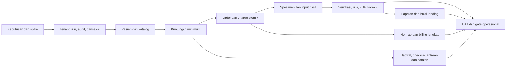

# Rencana implementasi

Sumber: [PRD.md](PRD.md), versi 0.1. Disusun 21 Oktober 2026.
Status: usulan pelaksanaan untuk ditinjau. PRD masih draft; keputusan klinis, regulasi, dan bisnis yang terbuka tetap memerlukan pemilik keputusan.

Workspace saat penyusunan hanya berisi PRD, tanpa implementasi aplikasi. Rencana ini dimulai dari proyek baru. Daftar pekerjaan ada di [TASKLIST.md](TASKLIST.md).

**Pembaruan 13 November 2026 (PRD 0.2):** implementasi sudah berjalan dan terlalu condong ke alur laboratorium. Urutan baru: (1) UI design system AdminMart di Tailwind (T15), (2) perbaikan integritas data (T16), (3) klinik pratama inti: NIK/BPJS, charge konsultasi, ICD-10, penutupan kunjungan (T17), (4) farmasi dan resep (T18), (5) kasir BPJS, laporan, kesiapan SATUSEHAT (T19). Pekerjaan lab lengkap, non-lab bertemplate, booking publik dan landing dibekukan sampai Fase 2. Bagian di bawah tetap berlaku sebagai rincian, kecuali yang bertentangan dengan urutan ini.

## 1. Sasaran dan batas pekerjaan

Bangun satu alur yang dapat ditelusuri: pasien → appointment/walk-in → kunjungan → order → spesimen atau pelaksanaan non-lab → hasil → verifikasi/rilis → dokumen → administrasi pembayaran.

- Stack wajib: Go, React, PostgreSQL.
- MVP mencakup seluruh kebutuhan Must dan Should berlabel MVP sesuai PRD §26.1. Label Should menentukan urutan, bukan penghapusan diam-diam dari lingkup.
- Satu cabang aktif per tenant; tiga mode fasilitas tetap menjadi sasaran MVP. Mode pilot pertama menentukan urutan demonstrasi.
- Bahasa Indonesia, IDR, online-only, hasil lab manual, penyerahan hasil oleh staf.
- Tidak ada nilai rujukan, ambang kritis, diagnosis, atau interpretasi otomatis bawaan.
- Fase 2/3 mengikuti PRD: portal pasien, analyzer, gateway, multi-cabang, SSO, integrasi nasional, farmasi, dan PACS tidak masuk pekerjaan MVP.
- Log QC sederhana bersifat Could dan opsional. QC operasional fasilitas tetap wajib dijalankan sesuai prosedurnya.

Pilihan lebih kecil untuk dipertimbangkan: demonstrasikan alur lab mandiri lebih dahulu dengan data sintetis. Ini milestone internal, bukan pengurangan cakupan MVP atau izin penggunaan data pasien nyata.

## 2. Keputusan sebelum pekerjaan terkait dimulai

| Keputusan                                                                                        | Pemilik usulan                   | Batas penyelesaian                            | Keluaran                                          |
| ------------------------------------------------------------------------------------------------ | -------------------------------- | --------------------------------------------- | ------------------------------------------------- |
| Mode dan fasilitas pilot, cakupan Must/Should, layanan non-lab 1–2 jenis                         | PM + perwakilan fasilitas        | Sebelum kontrak domain dan template dibekukan | Baseline lingkup dan daftar skenario pilot        |
| DEC-01/06: verifikasi, rilis, pemisahan analis/verifikator, rilis parsial                        | Penanggung jawab lab + klinis    | Sebelum hasil/verifikasi                      | Kebijakan per kategori, izin, dan contoh transisi |
| Nilai kritis: penerima, tenggat, eskalasi, perilaku blokir/peringatan                            | Penanggung jawab lab + klinis    | Sebelum tugas nilai kritis                    | SOP dan konfigurasi yang disetujui                |
| DEC-02/04: gate pembayaran, refund, shift kasir                                                  | PM + keuangan fasilitas          | Sebelum billing final                         | Aturan persetujuan, saldo, dan penyerahan dokumen |
| DEC-07/08: sumber kode diagnosis, lisensi, template non-lab                                      | Klinis + PM                      | Sebelum modul terkait                         | Daftar sumber dan template yang disetujui         |
| Persetujuan, retensi, hosting/lokasi data, atestasi/TTE, permintaan sendiri, kewajiban integrasi | Ahli hukum/regulasi + fasilitas  | Kajian Fase 0; selesai sebelum data nyata     | Memo kewajiban terverifikasi dan dampak lingkup   |
| SEC-004: autentikasi/MFA; DEC-05: storage; PDF dan perangkat label                               | Tech lead + keamanan + fasilitas | Sebelum fondasi terkait                       | Catatan keputusan teknis dan bukti spike          |
| Nama produk, perusahaan/domain, privasi, syarat layanan, dukungan, demo, migrasi                 | PM + operasional + legal         | Sebelum publikasi landing                     | Konten final dan penanggung jawab lead            |
| Target performa, kapasitas, ketersediaan, backup dan biaya infrastruktur                         | Tech lead + PM                   | Sebelum uji beban dan provisioning produksi   | Target terukur yang disepakati                    |

Keputusan terbuka tidak menghalangi scaffolding, fixture sintetis, dan pengujian fondasi yang independen. Jangan mengaktifkan kebijakan klinis yang belum disetujui untuk data nyata.

## 3. Bagian PRD yang perlu diselaraskan

| Temuan                                                                                                  | Dampak                                                          | Tindak lanjut                                                                                                                |
| ------------------------------------------------------------------------------------------------------- | --------------------------------------------------------------- | ---------------------------------------------------------------------------------------------------------------------------- |
| LAB-001 bergantung ORD-010 yang berlabel Should, padahal spesimen adalah Must                           | Fondasi spesimen dapat terlewat                                 | Kerjakan konfigurasi minimum jenis spesimen/wadah sebelum LAB-001; lengkapi usulan penggabungan dan instruksi sebagai Should |
| VIS-001 bergantung ORD-001; VIS-006 ke ORD-005; ORD-005 kembali ke VIS-001                              | Dependensi tampak melingkar jika dikerjakan per modul utuh      | Pisahkan katalog minimum, kunjungan minimum, lalu order; jangan menunggu seluruh modul selesai                               |
| §24 menyebut penarikan hasil berstatus `ditarik`, tetapi §17 tidak mendefinisikannya                    | State machine dan dokumen bisa berbeda makna                    | Validator lab menentukan mekanisme penarikan; jangan menambahkan status sendiri                                              |
| BILL-004 memakai `tercatat_manual`, sedangkan §17.6/RPT-004 memakai `tercatat`                          | Rekonsiliasi dapat menghitung pembayaran manual secara salah    | Tentukan apakah manual adalah asal pencatatan atau status; samakan kontrak API, database, laporan dan AC                     |
| RPT-002 menyebut penerimaan spesimen pertama, lalu penerimaan spesimen pengganti untuk recollection     | Definisi TAT dapat menghasilkan angka berbeda                   | Sepakati contoh perhitungan TAT utama dan TAT total sebelum implementasi laporan                                             |
| RES-006 mensyaratkan PDF immutable; §24 meminta regenerasi dengan isi identik                           | Retry bisa menghasilkan PDF berbeda jika waktu/template berubah | Bekukan data dan versi template saat rilis; tentukan kesamaan isi vs hash biner pada spike PDF                               |
| Landing diminta di Fase 0, tetapi screenshot/klaim harus berasal dari build yang ada                    | Halaman awal berisiko mengklaim fitur yang belum dibangun       | Siapkan struktur/form lebih awal; publikasi klaim dan screenshot menunggu bukti build dan gate landing                       |
| Pengujian lebar publik menyebut 360 px, sementara LP-015 menyebut 320 px                                | Pengujian terlalu sempit dapat melewatkan kegagalan landing     | Uji landing mulai 320 px; booking mulai 360 px; keduanya zoom 200% untuk alur relevan                                        |
| Gate pelaksanaan tersedia di BILL-009, sementara ringkasan DEC-02 merekomendasikan gate penyerahan saja | Tim dapat menerapkan pembatasan yang berbeda                    | Konfirmasi opsi yang didukung; akses klinis, verifikasi, komunikasi nilai kritis selalu tetap tersedia                       |
| Tidak ada spesifikasi rinci impor pasien massal meskipun FAQ membahas migrasi                           | Fitur impor dapat masuk tanpa lingkup dan AC                    | Konfirmasi layanan onboarding; buat spesifikasi terpisah bila impor diperlukan                                               |

## 4. Pendekatan teknis

Gunakan modular monolith sesuai PRD §20: satu codebase Go dengan API dan worker terpisah, satu PostgreSQL, object storage privat kompatibel S3. Redis, message broker, dan microservices belum diperlukan oleh cakupan saat ini.

- Modul memiliki tabel sendiri. Orkestrasi sinkron memakai interface Go dalam satu transaksi; efek asinkron melalui outbox. Order dan charge tidak boleh berhasil sebagian.
- API `/api/v1` mengikuti OpenAPI. Gunakan kontrak yang sama untuk tipe klien React, validasi dan inventaris pengujian endpoint.
- Konteks tenant berasal dari sesi. Filter tenant, cabang, izin dan hubungan pelayanan berlaku di backend; evaluasi RLS sebagai pertahanan tambahan sesuai rekomendasi PRD.
- Terapkan audit append-only, histori entitas, idempotency, optimistic locking, constraint database dan state machine sejak fondasi.
- Job memakai PostgreSQL, retry dan kegagalan permanen yang terlihat. PDF, scan file, notifikasi, ekspor dan retensi memakai mekanisme yang sama.
- Aplikasi internal berupa React SPA; booking memakai bundle publik ringan; landing berupa HTML pre-render dengan deployment terpisah.
- Pilih library saat fondasi/spike berdasarkan kebutuhan nyata. Framework, versi, dan vendor belum diputuskan oleh dokumen ini.
- Setiap potongan fitur mencakup migrasi, domain/API, otorisasi, audit, antarmuka, fixture sintetis dan pengujian yang relevan.

## 5. Urutan pengerjaan

Durasi berikut adalah perkiraan awal penulis, bukan angka dari PRD atau komitmen jadwal. Asumsi kapasitas: 2 engineer backend, 2 frontend, 1 QA, dukungan DevOps paruh waktu, serta PM/desainer dan validator fasilitas yang tersedia. Hitung ulang setelah discovery dan spike. Jika kapasitas lebih kecil, pertahankan urutan dependensi dan revisi durasinya.

| Tahap                        | Perkiraan  | Pekerjaan                                                                                                                          | Bukti selesai                                                                                     |
| ---------------------------- | ---------- | ---------------------------------------------------------------------------------------------------------------------------------- | ------------------------------------------------------------------------------------------------- |
| M0: discovery dan keputusan  | 2–3 minggu | Wawancara 3–5 fasilitas, keputusan domain/regulasi, prototipe setelah mode desain disepakati, spike PDF/barcode, fondasi form demo | Baseline lingkup, keputusan penghambat, hasil spike dan skenario UAT                              |
| M1: fondasi                  | 3–4 minggu | Struktur proyek, CI, skema, tenant/IAM, audit, transaksi, worker, file aman, komponen antarmuka dasar                              | Dua tenant sintetis; login/izin/isolasi diuji; deployment staging                                 |
| M2: pendaftaran sampai order | 4–5 minggu | Pasien, katalog, kunjungan minimum, billing dasar, order; kemudian jadwal/check-in/antrean                                         | Walk-in menghasilkan satu kunjungan, order, snapshot dan charge; booking aman terhadap konkurensi |
| M3: laboratorium dan hasil   | 4–6 minggu | Label, sampling, penerimaan/penolakan, input/rerun, verifikasi/rilis, kritis, PDF, koreksi                                         | Alur lab lengkap dan hasil koreksi dapat ditelusuri; versi lama tetap utuh                        |
| M4: kelengkapan MVP          | 4–5 minggu | Catatan klinis lengkap, non-lab, billing lengkap, merge final, laporan, seluruh Should MVP                                         | Ketiga mode lulus skenario lintas modul dan matriks izin                                          |
| M5: hardening dan pilot      | 3–5 minggu | Uji beban/aksesibilitas, pentest, restore, perangkat di lokasi, UAT/pelatihan, persetujuan go-live                                 | Bukti gate rekayasa dan operasional, lalu pilot terpantau                                         |

Jika tahap dijalankan berurutan, kisaran awalnya 20–28 minggu. Pekerjaan independen dapat bertumpang tindih setelah kontrak stabil; jangan menghitung penghematan sebelum kapasitas tim diketahui. Kewajiban integrasi baru, perubahan klinis, atau temuan pentest dapat mengubah kisaran ini.

Jalur dependensi utama:

## 6. Pembagian kerja dan cara menjalankan tasklist

| Penanggung jawab    | Fokus                                                                         |
| ------------------- | ----------------------------------------------------------------------------- |
| PM + fasilitas      | Lingkup, keputusan, penerimaan fitur, konten, koordinasi validator            |
| Backend             | Model domain, migrasi, API, izin, transaksi, worker, integrasi storage/PDF    |
| Frontend + desainer | Alur per peran, form, scan, konflik/simpan gagal, responsif dan aksesibilitas |
| QA                  | Fixture dua tenant, matriks akses, konkurensi, E2E, bukti UAT dan regresi     |
| DevOps + keamanan   | CI/CD, secrets, TLS/enkripsi, backup, observability, pentest dan insiden      |
| Klinis/lab/legal    | Persetujuan kebijakan dan konfigurasi dalam kewenangannya                     |

Ambil task yang dependensinya sudah selesai. Tetapkan satu pemilik dan tautan bukti pada tiap task saat eksekusi. Review per minggu mencakup keputusan tertunda, demo alur nyata dengan data sintetis, kegagalan pengujian dan revisi perkiraan.

Task baru boleh dicentang jika kriteria selesai dan AC sumbernya terpenuhi. UI yang terlihat selesai tetapi API/izin/audit belum berfungsi tetap dianggap belum selesai.

Merge pasien diselesaikan setelah semua tabel domain tersedia agar seluruh referensi berpindah atomik. Mekanisme histori dan pemetaan merge tetap dirancang sejak skema awal.

## 7. Strategi validasi

Pengujian tumbuh bersama fitur. Jangan menunda tes isolasi, otorisasi atau transaksi sampai tahap hardening.

| Area              | Bukti minimum                                                                                                                                       |
| ----------------- | --------------------------------------------------------------------------------------------------------------------------------------------------- |
| Domain            | Transisi valid/invalid, snapshot, saldo uang integer, koreksi immutable, TAT berbasis contoh yang disepakati                                        |
| PostgreSQL        | MRN dan charge unik, kapasitas slot, FK tenant, rollback lintas modul, audit tidak bisa diubah; RLS bila dipilih                                    |
| API dan akses     | Dua tenant sintetis; akses silang 404; matriks peran × aksi × status × hubungan pelayanan, termasuk endpoint file, ekspor dan publik                |
| Konkurensi        | 50 booking paralel pada slot kapasitas 1 menghasilkan satu keberhasilan; uji kapasitas >1, check-in/order/pembayaran/rilis ganda dan edit usang     |
| Idempotency       | Payload sama mengembalikan respons asli; payload berbeda dengan kunci sama ditolak 422; worker replay tidak menggandakan efek                       |
| E2E               | Klinik, lab mandiri dan kombinasi; non-lab tanpa spesimen; pembayaran sebagian, penolakan spesimen, kritis, koreksi dua kali, kegagalan koneksi/PDF |
| Keamanan file/log | EICAR dikarantina; URL kedaluwarsa ditolak; log/trace/error tracking/analytics tanpa data sensitif                                                  |
| UX/perangkat      | Keyboard, screen reader, zoom 200%, browser/perangkat PRD; scanner HID dan printer diuji pada wadah aktual                                          |
| Operasional       | Restore terisolasi dengan RTO/RPO terukur, integritas hash PDF/rantai hasil, alert dan prosedur downtime                                            |
| Performa          | Ukur NFR-001/002 pada profil beban yang disepakati; volume besar NFR-009; catat lingkungan dan hasilnya                                             |

## 8. Gate penerimaan

### Demo internal

Gunakan data sintetis berlabel. Demo memperlihatkan alur yang sudah berfungsi beserta keterbatasannya. Ini belum berarti aplikasi siap melayani pasien.

### Selesai secara rekayasa

Seluruh AC Must/Should MVP lulus, tes tenant/izin/konkurensi/audit/koreksi lulus, NFR terukur, log bersih, pentest tidak memiliki temuan kritis/tinggi terbuka, dan drill restore memenuhi target. Simpan bukti di laporan rilis.

### Publikasi landing

Seluruh klaim sesuai build, screenshot staging berlabel, daftar integrasi sesuai bukti, privasi/syarat layanan dan konten TBD final, form sampai notifikasi sales lulus, analytics tanpa data pribadi, SEO/performa dan aksesibilitas memenuhi target. Landing boleh dipublikasikan terpisah setelah gate ini terpenuhi.

### Data pasien nyata

Penuhi seluruh PRD §26.3: kontrak dan lokasi data, konfigurasi klinis/template disetujui, SOP fasilitas, peran/MFA, UAT, perangkat di lokasi, pelatihan/downtime, monitoring/dukungan, kajian regulasi dan persetujuan go-live fasilitas/lab/pemilik produk.

Persetujuan tersebut adalah kebutuhan rilis produk dari PRD; penyusunan dokumen rencana ini tidak membutuhkan persetujuan go-live.

## 9. Langkah pertama

Mulai dari T00-01 sampai T00-03: tetapkan pemilik keputusan dan pilot, selaraskan aturan yang bertentangan, lalu susun contoh alur dan matriks penerimaan. Setelah itu jalankan spike teknis dan fondasi yang independen. Implementasi aplikasi belum dimulai dalam pekerjaan penyusunan rencana ini.
